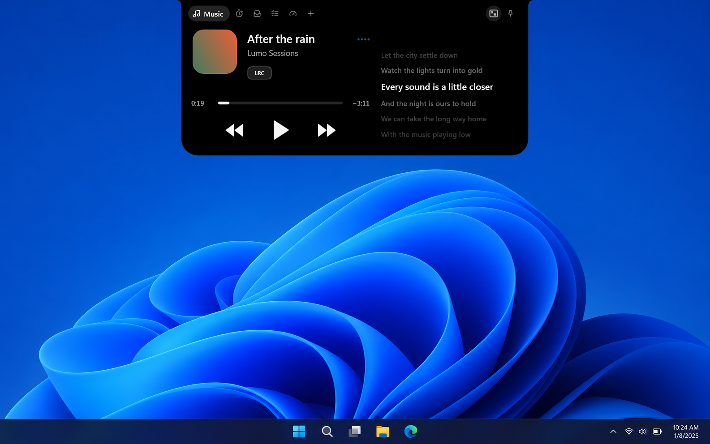
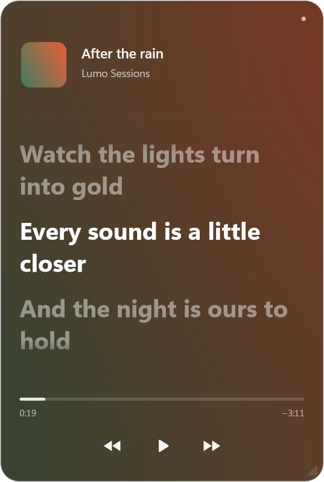
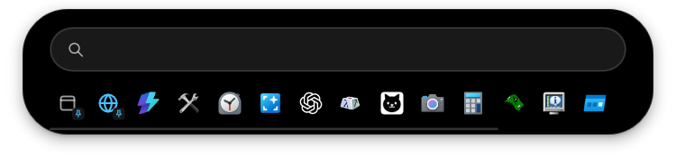
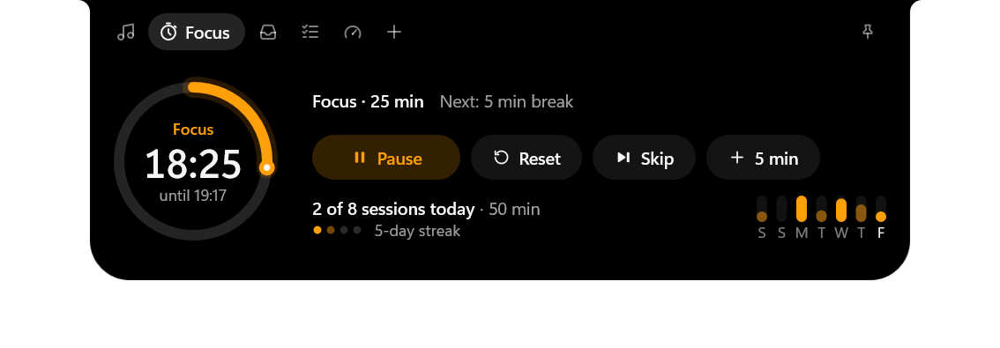
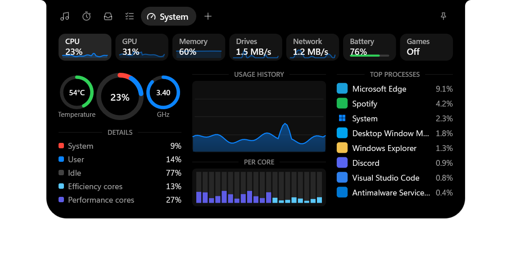
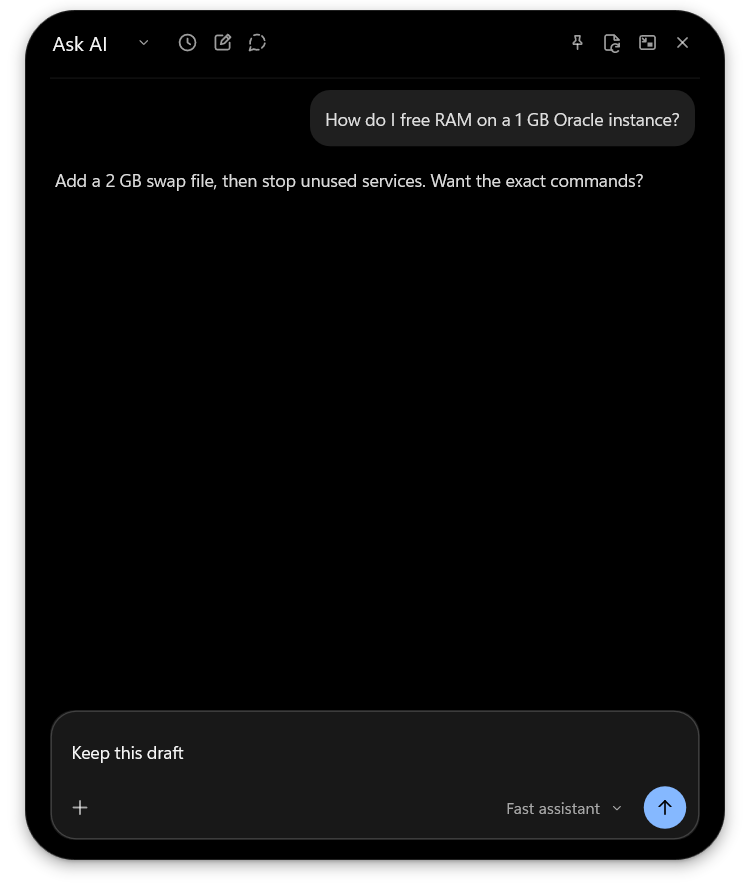
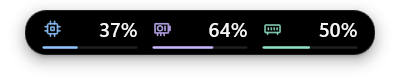
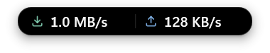

<div align="center">


# Lumo

### Hello, island.

A living island for your Windows desktop.<br>
Your music, focus timer, files and AI companion — close at hand.

<br>

[](https://github.com/mthlpbs/Lumo/releases/latest)

[](https://github.com/mthlpbs/Lumo/releases/latest)
[](#install)
[](LICENSE)
[](PRIVACY.md)

[Features](#features) · [Install](#install) · [FAQ](#faq) · [Guides](#guides) · [Development](#development)

<br>



<sub>Desktop preview: original Lumo capture on an illustrated Windows background. Screenshots use demo data.</sub>

</div>

<br>

## Small island. Big desktop.

Lumo sits quietly at the top of your screen and opens when you need it.

- **Stays out of the way.** Over a maximized app, it hides until you hover at the top edge.
- **Light on your PC.** Background work is opt-in. Readings only run while you can see them, and everything rests when the screen locks, the display turns off or battery saver is on.
- **Yours.** No Lumo account. Settings, tasks, focus history and saved chats stay on your PC. MIT licensed.

<br>

## Features

<table>
<tr>
<td width="50%" valign="top">

### 🎵 Music, with synced lyrics
Control any player that uses Windows media controls. Lyrics come from LRCLIB or your own library, and the current line can stay on the closed island. Click a lyric to jump to it.



</td>
<td width="50%" valign="top">

### 🔎 Search everything
Scroll down over the island to find apps, Windows settings, services, PowerToys tools and VS Code commands. Pin favourites, or search the web without leaving the island.



</td>
</tr>
<tr>
<td width="50%" valign="top">

### ⏱️ Focus
A Pomodoro timer with its countdown on the closed island, a daily goal, streaks and your last seven days. When a session ends, an optional soft glow blooms across the top of your screen.



</td>
<td width="50%" valign="top">

### 📱 Phone Drop
Scan a QR code and send files from your phone over Wi-Fi. Lumo always asks before accepting, and nothing leaves your local network.


</td>
</tr>
<tr>
<td width="50%" valign="top">

### 📊 Know what your PC is doing
CPU, GPU, memory, drives, network and battery in one place, plus optional FPS readouts over borderless full-screen games.



</td>
<td width="50%" valign="top">

### ✨ Ask AI
Open ChatGPT, Gemini, Claude or Muse right in the island, or switch on the native AI companion with your own provider and key. It's off by default.



</td>
</tr>
</table>

<details>
<summary><b>And the small things</b></summary>

<br>

| | |
| --- | --- |
| **Compact views** | Shift + mouse wheel over the closed island cycles Time, Performance (CPU · GPU · RAM) and Network. |
| **Shelf** | Keep files and links close, then drag them into any app. |
| **Tasks** | A small local to-do list. |
| **Script reader** | A teleprompter beneath your webcam. Enable it from Add-ons. |
| **Clipboard history** | Copied text kept in memory, respecting password-manager privacy markers. |
| **Notices** | Brief volume, charging and headset notices. |

 

</details>

### Classic or Pill

Choose an island that meets the top edge, or a floating pill with a little space around it. Same pages, same controls. Switch any time in **Settings › Appearance**.

<div align="center">

</div>

<br>

## Install

<div align="center">

**[⬇ Download the latest release](https://github.com/mthlpbs/Lumo/releases/latest)**

</div>

| Download | Good for |
| --- | --- |
| **Installer (.exe)** | Recommended. Installs for your Windows account. No administrator rights needed. |
| **Portable ZIP** | Extract the whole ZIP, then run `Lumo/lumo.exe`. |
| **SHA256SUMS.txt** | Check that your download's SHA-256 matches. |

Windows 10 & 11 · x64. WinGet publishing is paused; package-manager publishing currently targets Scoop only ([details](docs/package-managers.md)).

### Your first minute

| To… | Do this over the closed island |
| --- | --- |
| Open Lumo | Click it |
| Switch pages | Scroll up/down over the header, or click a tab |
| Search apps & settings | Mouse wheel **down**, or touchpad **right** |
| Ask AI (when enabled) | Mouse wheel **up**, or touchpad **left** |
| Cycle compact views | **Shift** + mouse wheel, or touchpad up/down |
| Keep it open | Click the pin |

Over a maximized app, hover at the top edge to reveal the island. To open it by hover everywhere, choose **Settings › General › Open island with › Hover**. **Settings › Shortcut guide** lists every key and gesture.

<br>

## FAQ

<details>
<summary><b>Is Lumo free? Do I need an account?</b></summary>

<br>

Yes, it's free. The code is MIT licensed, and the core features need no Lumo account. Ask AI uses your own provider and API key, and that provider may charge for requests. See [PRIVACY.md](PRIVACY.md) for what each network feature sends.
</details>

<details>
<summary><b>How do updates work?</b></summary>

<br>

Open **Settings › About** and choose **Check for updates**. A newer release offers **Download update**, then **Install and restart** once it's verified.

**Automatically update Lumo** downloads verified updates and installs them on the next launch. **Tell me about new versions** controls notifications separately. Both are off by default, and manual checks work either way. [How updates are verified](docs/updates.md).
</details>

<details>
<summary><b>Will it cover my tabs or full-screen apps?</b></summary>

<br>

Over maximized apps, the island only appears when you hover at the top edge. The window button beside the gear can keep it visible over a particular app, and Lumo remembers that choice. **Settings › Display** controls maximized and full-screen behavior.
</details>

<details>
<summary><b>Does it need administrator rights?</b></summary>

<br>

No. The installer runs for your Windows account. Only the optional FPS readout needs a one-time permission to join Windows' Performance Log Users group, and its System page explains why before asking.
</details>

<details>
<summary><b>What stays on my PC?</b></summary>

<br>

Settings, tasks, focus history and saved chats stay on your PC. AI requests go to the provider you choose, lyrics lookups use their configured services, and enabled update checks contact this project's public GitHub releases. Phone transfers ask before accepting files. Uninstalling keeps your settings, tasks, focus history and received files. Details are in [PRIVACY.md](PRIVACY.md).
</details>

<details>
<summary><b>Where can I report a problem?</b></summary>

<br>

[Open an issue](https://github.com/mthlpbs/Lumo/issues/new) with your Windows version, the Lumo version from **Settings › About**, and steps to reproduce it. Review `%LOCALAPPDATA%\Lumo\lumo.log` before attaching it, because logs can contain file paths or media information.
</details>

<br>

## Guides

<details>
<summary><b>Music, local lyrics and downloaded lyrics</b></summary>

<br>

Under **Settings › Music & lyrics**, enable **Use local lyrics** and choose your Music folder. Lumo reads matching sidecar `.lrc`, `.lyrics` and `.txt` files, plus embedded MP3, FLAC, M4A and Opus/Ogg lyrics. Timed lyrics keep their timestamps; plain text stays unsynced. LRCLIB fills in missing lyrics.

**Save downloaded lyrics** uses the song's exact filename with a `.lrc` extension, beside the song or in a separate download folder. Existing files are kept, and ambiguous or unmatched songs are not saved.

The **LRC** button controls closed-island lyrics. The mini-player button beside Pin opens a resizable lyrics player. Scroll over the expanded player to change tracks: up for previous, down for next (**Settings › Music › Scroll to change tracks**). Korean and Chinese pronunciation can appear beneath the original text.

Apple Music works through Windows media controls. Matched lyrics from LRCLIB and local lyric files work without an Apple Music token.
</details>

<details>
<summary><b>Search, web and the mini browser</b></summary>

<br>

Typing reveals matching apps, settings and tools, with matching pins first. Right-click a result for administrator, copy-path and icon-copy actions. Optional sources (Windows services, PowerToys tools, VS Code commands) each have their own toggle in **Settings › Search**.

Optional web search opens Bing, Google, DuckDuckGo or Brave inside the island, using the installed Edge WebView2 Runtime. No browser engine is bundled. `Ctrl+Enter` searches the current query; `Ctrl+L` edits the address. The mini-browser icon moves a page into a separate, resizable window that stays on top. Full details are in [the search guide](docs/search.md).
</details>

<details>
<summary><b>Phone Drop over your local network</b></summary>

<br>

Open **Shelf › Phone**, connect both devices to the same Wi-Fi, and scan the QR code, or use **Copy link**. Select files on your phone and accept them on the PC. New files go to Windows **Downloads**, or to a folder you choose in **Settings › General › Phone Drop**. Click **Done** to end the session. Phone Drop is local-only.
</details>

<details>
<summary><b>AI companion</b></summary>

<br>

Turn on **AI companion** in **Add-ons**, then scroll up (mouse) or left (touchpad) over the closed island. Bring your own provider, key and models; attach images, PDFs or text documents when your model supports them. History is encrypted for your Windows account, and temporary chats are not saved. Ask AI is a prototype: provider capabilities, usage limits and charges still apply. See [setup and limits](docs/ai-companion.md) and [AI workspace details](docs/ai.md).
</details>

<details>
<summary><b>Game readouts and shortcuts</b></summary>

<br>

Enable **Show over games** under **System › Games**. Windows frame tracing asks for its one-time permission there. Press `Alt` + `Shift` + `F` to hide or show the readout while a game is in front. The tray menu has **Start with Windows**, **Settings** and **Exit**.
</details>

<details>
<summary><b>Settings, saved data and migration</b></summary>

<br>

| Location | Path |
| --- | --- |
| Installed app | `%LOCALAPPDATA%\Programs\Lumo\lumo.exe` |
| Settings and data | `%APPDATA%\Lumo\` |
| Cache and log | `%LOCALAPPDATA%\Lumo\` |
| Received files | Windows Downloads, or the folder selected in Settings › General |

Existing profiles are imported into Lumo once, with the original folders kept as backups. Lumo uses `lumo.exe` and `LUMO_*` environment variables.
</details>

<br>

## Development

Lumo is a Windows-only Cargo workspace with a native Win32, Direct2D and WinRT interface, written in Rust.

```powershell
cargo test --workspace --locked
cargo build -p lumo --release --locked
```

The executable is `target/release/lumo.exe`. To build the standalone EXE, portable ZIP and setup installer together, run `./tools/package.ps1` ([packaging options](docs/packaging.md)). Read [AGENTS.md](AGENTS.md) before changing the app: keep background work opt-in, load heavy Windows components on demand, and measure CPU in cycles.

<details>
<summary><b>Workspace, self-test, versioning and releases</b></summary>

<br>

| Component | Purpose |
| --- | --- |
| `crates/lumo` | The Windows application and its UI and services. |
| `crates/lumo-core` | Shared models, parsing, settings and other core logic. |
| `server` | Historical paired-phone server and test tooling. The Windows app uses local Phone Drop. |

**GNU cross-build:** with a MinGW toolchain, `cargo wcheck` checks the Windows target and `cargo wbuild` builds `target/x86_64-pc-windows-gnu/release/lumo.exe`.

**Graphical self-test:** uses an isolated data directory and demo data, and writes screenshots plus `report.json` with layout and timing checks.

```powershell
.\target\release\lumo.exe --selftest selftest-out
```

`LUMO_SELFTEST_THEME=classic` or `pill` selects a theme; `LUMO_SELFTEST_DPI=144` renders at 150% scaling.

**Versioning:** versions use `year.monthday.build`. `2026.1107.2` means 7 November 2026, build 2; January 7 uses `2027.107.1`, without leading zeros. The build counter runs from 1 to 65535, and every published app release gets a new number.

Keep these aligned before tagging:

- `Cargo.toml` and the `lumo` / `lumo-core` entries in `Cargo.lock`
- `crates/lumo/res/lumo.rc` and `crates/lumo/res/lumo.manifest`
- `installer/lumo.nsi` and `installer/lumo.iss`

Add `docs/release-notes/v<version>.md` and use it as the release text. Publish a GitHub release with the matching numeric tag, such as `2026.1107.2`. The [ci workflow](.github/workflows/ci.yml) tests and builds Windows, checks the installer, and attaches the installer, portable ZIP and checksums. Saving a draft or pushing a tag alone does not build; publishing a release or pre-release does.

For a release rehearsal, use **Actions › ci › Run workflow**, or:

```powershell
gh workflow run ci.yml --ref <branch> -f release_dry_run=true
```

Manual runs publish nothing.
</details>

<br>

## Credits and license

Lumo is maintained by [**mthlpbs**](https://github.com/mthlpbs) and is a modified version of [Oyenza Studio](https://github.com/lucacadalora/oyenza-studio), by Jatevo Labs and its contributors. Original copyright notices and third-party licenses are preserved.

Synced lyrics use [LRCLIB](https://lrclib.net). Built with Rust, [windows-rs](https://github.com/microsoft/windows-rs) and [serde](https://serde.rs). Code is licensed under [MIT](LICENSE); [THIRD-PARTY-NOTICES.txt](THIRD-PARTY-NOTICES.txt) ships with every download.

<br>

<div align="center">


**Hello, island.**

<sub>If Lumo makes your desktop a little calmer, a ⭐ helps others find it.</sub>

</div>
