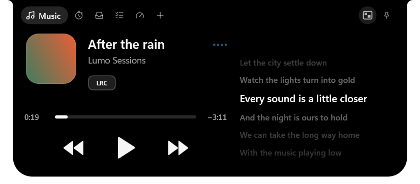
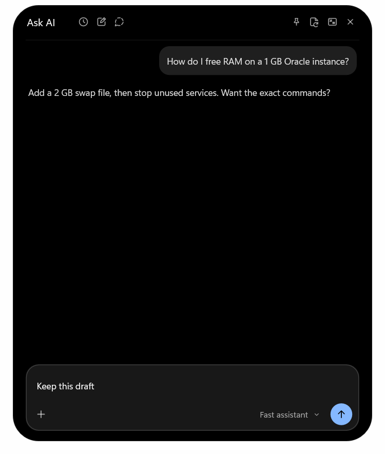
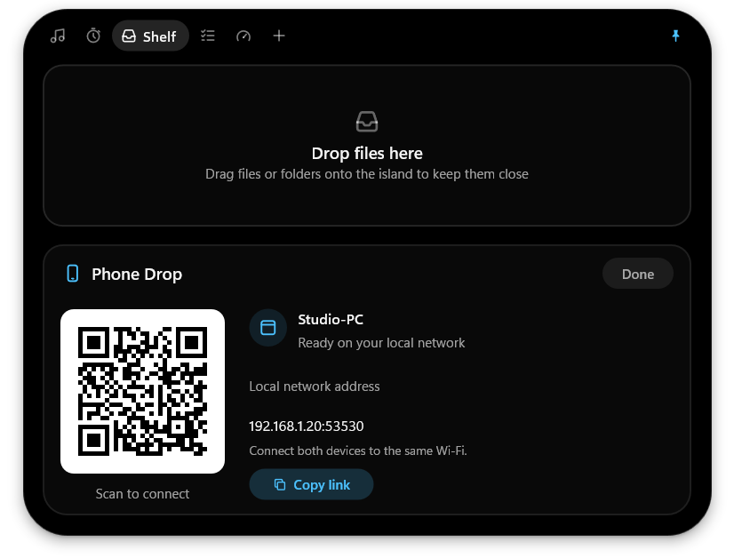
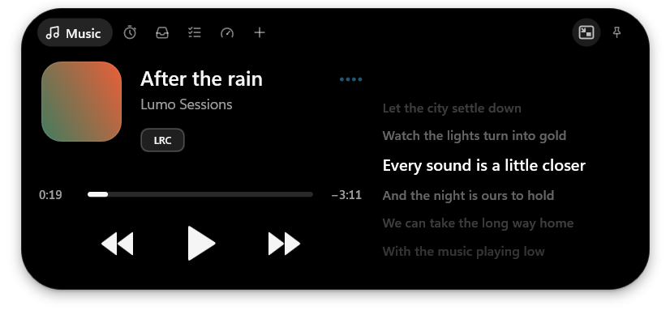
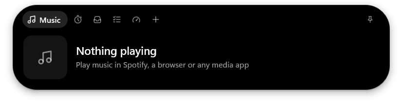

<p align="center">
  
</p>

<h1 align="center">Lumo</h1>

<p align="center"><strong>A living island for your Windows desktop.</strong></p>

<p align="center">
  Your music, focus timer, files and AI companion, close at hand.<br>
  A small island at the top of your screen that opens when you need it.
</p>

<p align="center">
  <a href="#features">Features</a> &nbsp;·&nbsp;
  <a href="#install">Install</a> &nbsp;·&nbsp;
  <a href="#faq">FAQ</a> &nbsp;·&nbsp;
  <a href="#guides">Guides</a> &nbsp;·&nbsp;
  <a href="#development">Development</a>
</p>

<p align="center">
  
</p>

<p align="center"><sub>Windows 10 &amp; 11 · x64 · Free and open source · No Lumo account needed</sub></p>
<p align="center"><sub>Maintained by <a href="https://github.com/mthlpbs">mthlpbs</a>. Based on <a href="https://github.com/lucacadalora/oyenza-studio">Oyenza Studio</a>. Screenshots use demo data.</sub></p>

## Install

Get the [latest release](https://github.com/mthlpbs/Lumo/releases/latest),
or use these pinned **2026.1107.2** downloads:

| Download | Get started |
| :--- | :--- |
| **[Installer (.exe)](https://github.com/mthlpbs/Lumo/releases/download/2026.1107.2/Lumo-Setup-2026.1107.2.exe)** | Recommended. Installs for your Windows account without administrator rights. |
| **[Portable ZIP](https://github.com/mthlpbs/Lumo/releases/download/2026.1107.2/Lumo-2026.1107.2-portable.zip)** | Extract the whole ZIP, then run `Lumo/lumo.exe`. |
| [Checksums](https://github.com/mthlpbs/Lumo/releases/download/2026.1107.2/SHA256SUMS.txt) | Compare the download's SHA-256 with `SHA256SUMS.txt`. |

To build the current source, use the [local packaging script](docs/packaging.md).
It creates a standalone EXE, portable ZIP and setup installer in `dist/<version>/`.

WinGet and Scoop distribution is prepared but not yet published. Maintainers can
follow the [one-time setup and automatic release updates](docs/package-managers.md).

**First time here?** Click the island to open it. Scroll vertically over its
header to switch pages. With a mouse, scroll **down** over the closed island
for Search or **up** for AI when enabled. With a touchpad, scroll **right** for
Search or **left** for AI; a fresh horizontal gesture closes either
surface. The gear opens
Settings; the pin keeps the island open.

Over a maximized app, hover at the top edge to reveal the island, then click
to open it. To open by hover over normal windows, choose **Settings > General >
Open island with > Hover**.

## Features

The main pages are **Music**, **Focus**, **Shelf**, **Tasks**, **System** and
**Add-ons**. **Script reader** and **Clipboard history** appear when enabled.
**Ask AI** opens separately with mouse wheel up or touchpad left scroll, outside the tab row. Open **Settings** from the gear in the header.

### Search apps and Windows settings

Scroll **down with a mouse wheel** or **right with a touchpad** over the closed
island to open Search. Swipe
again anywhere over Search to collapse it. Open pages keep their normal
horizontal navigation. Clicking outside closes Search immediately, even after wheel opening without
activation, unless its Keep open
pin is enabled, including after dismissing a result's context menu. The compact
list shows frequently opened results first, with native Windows icons and a
clear selection marker. VS Code commands use a small source icon; PowerToys
uses installed tool icons with readable vector fallbacks. The native result
menu has compact grouped actions for opening, copying and frequent results.
The island fits the
number of results, so a single match uses just one row. When nothing matches,
the island shrinks around a web-search card with your selected engine and
query preview. Optional Google suggestions can appear beneath it; turn them
on in **Settings > Search**. They send unmatched text or address-bar search text to Google after you pause
typing and are off by default. Website addresses are excluded.

**Settings > Search** controls applications, Windows Settings and optional web
search. Right-click results for dark native Windows menus with administrator
actions where supported, copy-path and separate icon-file/icon-image copying.
Frequent results can be removed individually. Lumo commands and preference pages are excluded.

Search can also find **Windows services**, installed **PowerToys tools**, and
**VS Code commands**. Enable services to see their last-read state and explicit
Start/Stop buttons; Windows asks for administrator access when needed.
PowerToys results include tool settings and enabled tools from its running app.
VS Code commands appear only for open Code or Code Insiders windows. Selecting
a command uses that existing window; Lumo never starts VS Code for it. Closed
windows are discarded from cached search results.
These extra sources refresh on opening Search or through **Refresh search
sources**. Each source has its own toggle in **Settings > Search**.

Optional web search opens Bing, Google, DuckDuckGo or Brave inside the island,
using the installed Edge WebView2 Runtime. It starts only when you choose a
web action, or press <kbd>Ctrl+Enter</kbd> to search the current query with your
chosen engine (an empty field opens its home page). The neutral search field has
no browser button. A unified address bar contains navigation, refresh/stop,
default-browser, mini-browser, pin and resume icons. It shows the webpage title
while browsing; click or press <kbd>Ctrl+L</kbd> to edit the full URL with all icons
hidden. Double-click selects the entire URL, including slashes. Optional Google
suggestions also work while typing an address-bar search. Loading fills the
rounded bar and follows its bottom edge. Search has no close button; press
<kbd>Esc</kbd> or swipe horizontally to close it.
The browser expands vertically at the same width as Search by default.
**Settings > Search > Browser** offers Tall or Wide layout and height presets.
Pages open at their normal size with a desktop user agent; Lumo does not zoom
them to fit the window. Type a URL or bare domain such as `hirunews.lk` to see
**Visit** and open it directly instead of searching for it.
The mini browser icon moves the current page into a separate, resizable window
that stays on top. Return it to the island with the matching return icon;
the page and its history stay intact. Local app search remains available
while the mini browser is open. Resize it diagonally from any corner, or use an edge,
freely from 280 × 200 up to your
screen's available space; its size is remembered. Loading progress fills the
address field, and the search-to-browser transition fades smoothly.
No browser engine is bundled. [Search controls and scope](docs/search.md).

<p align="center">
  
</p>

### Music that stays within reach

Control the music apps that use Windows media controls, seek through a track,
and follow matched lyrics from LRCLIB or your local library. The current line
can stay on the closed island. Music uses a shared layout in Classic and Pill:
artwork, a clear title and artist, a seek bar and widely spaced
playback controls, with synced lyrics beside the player. Click a timed lyric
to seek to that line. **Settings > Music > Lyrics in Music** hides or restores
the column independently of closed-island lyrics. The LRC button replaces
the player/application name and switches
closed-island lyrics. Select the mini player icon beside Pin in Music to open a
separate, resizable player with lyrics. All four corners support diagonal resizing. Its exit mini player icon returns to
Music in the island; the same icon is available in Music while the mini player
is open.

Compact Pill music uses the same 32-DIP height across songs and lyric-loading
states, with a single lyric line and a plain black background. Pronunciation
readings appear in expanded Music and in Classic's two-row compact layout.

Scroll over the expanded player to change tracks: **up** goes to the previous
track and **down** goes to the next. Turn this off in **Settings > Music >
Scroll to change tracks**. Both new Music switches are on by default. The
lyrics area keeps text scrolling, and scrolling over the header changes sections.

<p align="center">
  
</p>

Korean and Chinese pronunciation can appear beneath the original text.
[Music setup and local files](#guides) are covered below.

### Your compact views

Use **Shift + mouse wheel** or touchpad up/down over the closed island to cycle **Time & activities**,
**Performance** (CPU, GPU and RAM) and **Network**.
Time is the default; Music and Focus still appear in that view as usual.
Click a metric view to open System. Unavailable readings show a dash.
Performance uses CPU/GPU/RAM icons, percentages and small usage meters;
Network uses download/upload icons beside the transfer rates. Values use the
clock’s text size plus one DIP, without written labels. Both update once a second while visible. Returning
to Time releases the compact sampler, with no timer wakeups or background
history collection. Lock, display-off, battery saver and opening another page
also put compact readings to sleep.

In **Settings > Appearance**, choose 12- or 24-hour time, a clock font and
color, or **Windows accent (wallpaper-derived)**. Windows controls whether
its accent follows the wallpaper. The same page can disable compact-view scrolling.

<p align="center">
  
  <br>
  
</p>

### Ask AI without leaving your desktop

Turn on **AI companion** in **Add-ons**, then scroll **up with a mouse wheel**
or **left with a touchpad** over the closed island. Mouse down or touchpad right
opens Search. AI has its own tall, browser-sized workspace
with a full conversation, a multiline composer and a quiet icon toolbar. It
does not appear among the regular island tabs. The Ctrl-hover shortcut remains
available. Bring your own provider, key and models; attach or paste images and
PDFs or UTF-8 text documents when your model supports them. Preview cards sit
above the message. Drop files onto the open workspace to attach them. The model
selector shows only the model name, directly beside Send. Temporary chats open
with their own history notice. Replies render native color emojis. Empty AI
composers and Search queries stay blank and hide the caret. Once text is
entered, the focused caret blinks normally. Clearing the field hides it again. Clicking outside the
attachment menu dismisses it. AI chat and composer text use 14 DIPs.
Toolbar icons in AI and the browser show their actions on hover. Attach,
the composer model selector and Send/Stop have no hover text.
Model provider names stay hidden on hover.

**Settings > AI companion > Hide unavailable models** is on by default and
appears only for Hack Club AI URLs. Turn it off to inspect disabled models and
their reasons. The funnel button opens a separate filter popover; hovering
over a model’s info icon previews its advertised capabilities, context and cost.
Click for the redesigned details sheet. Retirement metadata and explicit model refusals disable models;
Refresh updates the catalog and lets reported failures be tried again. Unknown
availability is not a guarantee that a model works. See [model availability](docs/ai-companion.md#model-availability).

The mini-window icon moves the same conversation into a resizable window at
the top right. Resize any corner diagonally or drag an edge. Its return icon brings it back without losing the draft,
attachments or reading position. **Keep open** prevents outside-click
dismissal. **Resume chat** restores the conversation and draft on reopening;
with it off, the next opening starts a fresh chat. Both switches default to
off and are also in **Settings > AI companion**. Mini size is remembered.

Search saved chat titles, use prompt starters that fill the composer without
sending, or jump to the latest reply while reading a long conversation. Send
is disabled for an empty message. [AI workspace details](docs/ai.md).

AI is off by default. Switching it off also hides its Settings section;
your provider settings, saved key, models and chats stay for when you turn it back on.

<p align="center">
  
</p>

Replies support Markdown, tables and copyable code blocks. History is
encrypted for your Windows account, and temporary chats are not saved.
**Ask AI is a prototype**; provider capabilities, usage limits and charges
still apply. [Setup and limits](docs/ai-companion.md).

### Files from your phone, with your permission

Keep files and links on the **Shelf**, drag them into another app, or scan
its QR code to send files from your phone over Wi-Fi. Lumo asks before
accepting an incoming transfer. Scan the local IP QR code or copy its link
to another nearby device.

<p align="center">
  
</p>

Works through your phone's browser on the same local network.
The redesigned phone page supports light and dark appearance.

### Know what your PC is doing

**System** brings CPU, GPU, memory, drives, network and battery information
into one place. Open a module for its history and details. Optional game
readouts show FPS, GPU and CPU information over borderless full-screen games.

<p align="center">
  
</p>

Counters are active while their page or an enabled readout needs them.
**Show over games** has its own switch under **System > Games**.

### Make room for the small things

| Page | What it keeps close |
| :--- | :--- |
| **Focus** | A Pomodoro timer, with its countdown on the closed island, a daily goal, streaks and the last seven days at a glance. |
| **Tasks** | A small local to-do list. |
| **Script reader** | A teleprompter beneath your webcam, enabled from Add-ons. |
| **Clipboard history** | Copied text in memory, with password-manager privacy markers respected. |

<p align="center">
  
</p>

In **Settings > Focus**, focus lengths include **30 minutes**. Daily goals
include **15, 18 and 24 sessions**, alongside the existing choices.

In **Settings > Focus > Completion lighting**, choose a color and click
**Preview** to test the spotlight while it is switched off. Enable
**Spotlight** to show it when a focus session ends. A soft glow blooms from the
island, spreads outward across the upper display, and fades to full transparency
in three seconds. It passes mouse input through and preserves keyboard focus.
The effect stops while locked, the display is off, or battery saver is on.

Script reader and Clipboard history are built in. Switch them on from the
**+ (Add-ons)** page when you need them, and off to stop them.

### Classic or Pill

Choose an island that meets the top edge, or a floating pill with a little
space around it. Both themes keep the same pages and controls, with brief
volume, charging and headset notices.

<p align="center">
  
</p>

Change themes under **Settings > Appearance**. The rest of the app stays
familiar.

## FAQ

<details>
<summary><strong>Is Lumo free? Do I need an account?</strong></summary>

Lumo's code is MIT licensed, and its core features need no Lumo account.
Ask AI uses your own provider and API key; that provider may charge for requests.
See [PRIVACY.md](PRIVACY.md) for what each network feature sends.

</details>

<details>
<summary><strong>How do updates work?</strong></summary>

Open **Settings > About** and choose **Check for updates**. A newer release
offers **Download update**, followed by **Install and restart** once verified.

**Automatically update Lumo** downloads verified updates and installs them on
the next launch. **Tell me about new versions** controls notifications
separately. Both switches default to off; manual checks work with both off.
Automatic work rests while the session is locked, the display is off, or
battery saver is on. [How updates are verified](docs/updates.md).

</details>

<details>
<summary><strong>Will it cover my tabs or full-screen apps?</strong></summary>

Over maximized apps, the island reveals itself when you hover at the top
edge. The window button beside the gear can keep it visible over a particular
app; Lumo remembers that choice. **Settings > Display** controls maximized
and full-screen behavior. The pin keeps the expanded island open.

</details>

<details>
<summary><strong>Does it need administrator rights?</strong></summary>

The installer runs for your Windows account without administrator rights.
The optional FPS readout needs a one-time permission to join Windows'
Performance Log Users group. Its System page explains that permission before
requesting it.

</details>

<details>
<summary><strong>What stays on my PC?</strong></summary>

Settings, tasks, focus history and saved chats stay on your PC. AI requests
go to the provider you choose, lyrics lookups use their configured services,
and enabled update checks contact this project's public GitHub releases.
Phone transfers ask before accepting files. Details are in
[PRIVACY.md](PRIVACY.md).

Uninstalling keeps settings, tasks, focus history and received files.

</details>

<details>
<summary><strong>Where can I report a problem?</strong></summary>

[Open an issue](https://github.com/mthlpbs/Lumo/issues/new) with your Windows
version, the Lumo version from **Settings > About**, and steps to reproduce it.
Review `%LOCALAPPDATA%\Lumo\lumo.log` before attaching it; logs can contain
file paths or media information.

</details>

## Guides

<details>
<summary><strong>Music, local lyrics and downloaded lyrics</strong></summary>

Under **Settings > Music & lyrics**, enable **Use local lyrics** and choose
your Music folder. Lumo reads matching sidecar `.lrc`, `.lyrics` and `.txt`
files, plus embedded MP3, FLAC, M4A and Opus/Ogg lyrics. Windows metadata
handlers may support other formats. Timed lyrics keep their timestamps;
plain text remains unsynced. LRCLIB supplies missing lyrics.

**Save downloaded lyrics** uses the matching song's exact filename with a
`.lrc` extension. Save beside the song or choose a separate download folder.
A Music folder or download folder must be configured before files are saved.
Existing files are kept, and ambiguous or unmatched songs are not saved.
Clean and explicit editions remain distinct.

The **LRC** button controls closed-island lyrics. The mini-player button beside Pin
opens a resizable lyrics player; clicking it again returns lyrics to the
island. Hide that button with **Lyrics window button** in Music settings.
Its position stays fixed during song changes; it dims while synced lyrics
are unavailable. Music controls do not show action descriptions on hover.
While the mini player is open, the island's LRC toggle is disabled. Returning
restores that toggle and inline lyrics when **Lyrics in Music** is enabled.
The player uses the full width while lyrics are in the mini window or hidden
in Music settings.

</details>

### Apple Music lyrics

Apple Music playback uses Windows media controls. Matched lyrics from LRCLIB
and local lyric files work without an Apple Music token. See
[PRIVACY.md](PRIVACY.md) for details about optional Apple Music requests.

<details>
<summary><strong>Phone Drop over your local network</strong></summary>

Open **Shelf > Phone**, connect both devices to the same Wi-Fi, and scan the
QR code, or use **Copy link** to open that local IP session address on another
device. New files save directly in Windows **Downloads**. Choose a different
folder in **Settings > General > Phone Drop**. Folder changes apply to the
next session. Existing received files stay at their current paths.

Select files on your phone and accept on the PC. Shelf files are available to
save from the phone page. The redesigned panel shows the destination, incoming
request and transfer progress. Click **Done** to end the session.

Phone Drop is local-only. Earlier internet pairing has been removed from the
Windows app, and existing pairs no longer start a service.

</details>

<details>
<summary><strong>Game readouts and shortcuts</strong></summary>

Enable **Show over games** under **System > Games**. Windows frame tracing
asks for its one-time permission there. Press
<kbd>Alt</kbd> + <kbd>Shift</kbd> + <kbd>F</kbd> to hide or show the readout while a game is in front. Choose
brief peeks if you do not want a persistent readout.

The tray menu contains **Start with Windows**, **Settings** and **Exit**.
Right-clicking the island has no action. Settings changes save immediately,
and a right touchpad scroll on the closed island opens Search; left opens AI
when enabled. A second horizontal gesture closes the open surface. Open pages and Settings keep their horizontal
page and category navigation. **Settings > Search > Open with horizontal
scroll** controls only the touchpad/right-scroll opening gesture.
**Settings > General > Mouse wheel shortcuts** defaults to on and controls
mouse up/down opening. Over an open Search/AI header, the next deliberate mouse-wheel gesture returns
to Time; a later gesture can open AI or Search again. Content scrolling keeps its normal behavior. Unknown
input sources retain touchpad-compatible behavior; see [input compatibility](docs/search.md#mouse-and-touchpad-input).

</details>

<details>
<summary><strong>Settings, saved data and migration</strong></summary>

| Location | Path |
| :--- | :--- |
| Installed app | `%LOCALAPPDATA%\Programs\Lumo\lumo.exe` |
| Settings and data | `%APPDATA%\Lumo\` |
| Cache and log | `%LOCALAPPDATA%\Lumo\` |
| Received files | Windows Downloads directly, or the folder selected in Settings > General |

Existing profiles are imported into Lumo once, with the original folders kept
as backups. An existing received-file inbox is reused to preserve Shelf links.
Retired themes load as Classic; old logs and obsolete update metadata are not
carried forward. Lumo uses `lumo.exe` and `LUMO_*` environment variables.

</details>

## Development

Lumo is a Windows-only Cargo workspace with a native Win32, Direct2D and
WinRT interface.

| Component | Purpose |
| :--- | :--- |
| `crates/lumo` | The Windows application and its UI and services. |
| `crates/lumo-core` | Shared models, parsing, settings and other core logic. |
| `server` | Historical paired-phone server and test tooling. The Windows app uses local Phone Drop. |

<details>
<summary><strong>Build and test</strong></summary>

Use Rust stable with the Windows MSVC toolchain:

```powershell
cargo test --workspace --locked
cargo build -p lumo --release --locked
```

To update the product version and build the standalone EXE, portable ZIP and
setup installer together, run `./tools/package.ps1`. Outputs go to
`dist/<version>/`. [Packaging options and checks](docs/packaging.md).

The executable is `target/release/lumo.exe`. For a GNU cross-build with a
MinGW toolchain, `cargo wcheck` checks the Windows target and `cargo wbuild`
builds `target/x86_64-pc-windows-gnu/release/lumo.exe`.

The graphical self-test uses an isolated data directory and demo data:

```powershell
.\target\release\lumo.exe --selftest selftest-out
```

It writes screenshots and `report.json` with layout and timing checks.
`LUMO_SELFTEST_THEME=classic` or `pill` selects a theme;
`LUMO_SELFTEST_DPI=144` renders at 150% scaling.
Read [AGENTS.md](AGENTS.md) before changing the app. Keep background work
opt-in, load heavy Windows components on demand, and measure CPU in cycles.

</details>

<details>
<summary><strong>Versioning and release builds</strong></summary>

Versions use `year.monthday.build`: `2026.1107.2` means 7 November 2026,
build 2. A later release that day uses `2026.1107.3`; the next day starts at
`2026.1108.1`. January 7 uses `2027.107.1`, without leading zeros.
The build counter runs from 1 to 65535. Rebuilding a commit keeps its version;
every published app release gets a new number.

Keep these files aligned before tagging:

- `Cargo.toml` and the `lumo` / `lumo-core` entries in `Cargo.lock`.
- `crates/lumo/res/lumo.rc` and `crates/lumo/res/lumo.manifest`.
- `installer/lumo.nsi` and `installer/lumo.iss`.

Add `docs/release-notes/v<version>.md` and use it as the release text. Commit
the workflow and source first, then publish a GitHub release with the matching
numeric tag, such as `2026.1107.2`. Historical `v`-prefixed tags also work.

The [ci workflow](.github/workflows/ci.yml) tests and builds Windows, checks the
installer, and attaches the installer, portable ZIP and checksums. Saving a
draft or pushing a tag alone does not build; publishing a release or
pre-release does. Non-version add-on tags are skipped, and mismatched app
versions fail validation. Re-running a failed job uses its original tagged
commit; publish a new matching version to include fixes instead of moving an
existing release tag.

For a release rehearsal, use **Actions > ci > Run workflow**, or:

```powershell
gh workflow run ci.yml --ref <branch> -f release_dry_run=true
```

Manual runs publish nothing. Installers are saved in `lumo-setup`; screenshots
and idle metrics are in `lumo-screens`. Dependabot checks action versions
daily. The app reads GitHub releases directly, so no update-feed or website
deployment is needed. Packaging writes the portable ZIP directly, without
leaving an unpacked `dist/Lumo` folder.

</details>

## Credits and license

Lumo is maintained by **mthlpbs** and is a modified version of
[Oyenza Studio](https://github.com/lucacadalora/oyenza-studio), by Jatevo Labs
and its contributors. Original copyright notices and third-party licenses
are preserved.

Synced lyrics use [LRCLIB](https://lrclib.net). The app is built with Rust,
[windows-rs](https://github.com/microsoft/windows-rs) and
[serde](https://serde.rs), with other dependencies listed in the notices.

Code is licensed under [MIT](LICENSE).
[THIRD-PARTY-NOTICES.txt](THIRD-PARTY-NOTICES.txt) ships with every download.

The expanded island uses its original horizontal section tabs. The active
section shows its icon and name, such as Music; other available sections show
icons. Scroll up/down over the header, swipe horizontally, or click a tab to
change sections. Settings is available from the tray icon's right-click menu.


