# AI workspace

Click the **Ask AI** title for a dropdown with ChatGPT, Gemini, Claude and Muse.
Website mode fills the island or mini window and overlays
its controls at the top right. It shares Lumo's embedded-browser cookies.
[AI websites and reply-ready previews](ai-sites.md) describes this mode; the
native Ask AI conversation below remains available from the same dropdown.

Enable **AI companion** in Add-ons. From the closed island, scroll **left** to
open AI and **right** to open Search. AI lives outside the normal page tabs;
ordinary island clicks still open the page appropriate to your current activity.
The existing Ctrl-hover AI shortcut also opens this workspace. Old AI start-page
preferences now open Music.
If no model is configured, **Connect a provider** opens AI Settings directly.

The workspace opens at the same 560-DIP width as the tall browser, with a
680-DIP height limited to your screen. It shows the full conversation. The
toolbar holds history, new chat, temporary chat, Keep open, Resume chat, mini
window and close. Settings is available from the tray icon’s right-click menu.
Toolbar icons show their actions on hover. The composer’s Attach, model selector
and Send/Stop controls have no hover text. Toolbar labels do not change focus or
start requests. Click model information explicitly for provider details.

Conversation text uses a shared 14-DIP scale in both hosts, with a comfortable
line height. User bubbles fit their message up to 80% of the conversation width;
assistant replies remain unboxed, with quieter text, compact headings and lists.
The composer uses the same text scale, including mouse selection and caret layout.

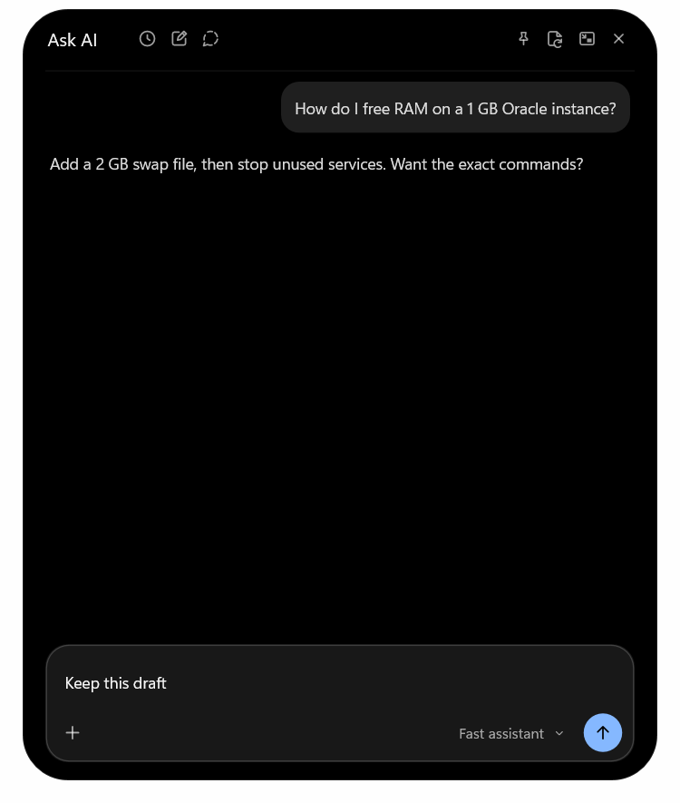

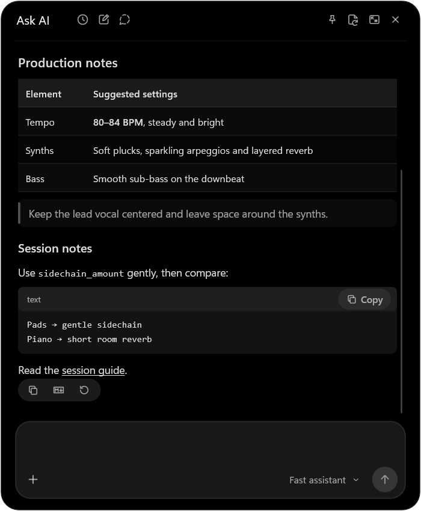

Write in the multiline composer. Enter sends; Shift+Enter adds a line. Send is
disabled for an empty draft; while waiting, it becomes Stop. The lower composer
row keeps the attachment menu at the left and the model picker beside Send
on the right, with an eight-DIP gap beside Send and no separate progress icon.
Only model names appear in the picker; provider names stay hidden on hover.
Attached images have thumbnails and documents have file cards, inside the composer
above the draft. Each card has a remove button and a filename tooltip. Ctrl+V
accepts copied images or up to four copied image, PDF or text files. Text paste still
works normally. Dragging supported files over an open AI workspace keeps it
open and attaches the files instead of switching to Shelf, including the mini
window. Single clicks position the caret; double-click selects the entire
message or Search query. Mouse selection follows wrapped lines and Unicode. Capture screen has been removed; there is no AI clipboard
listener or capture timeout. Previews decode once on the attachment worker.
Ctrl+N starts a new chat, Ctrl+Shift+N starts a temporary chat, Ctrl+H opens
local history, and Ctrl+K opens the model picker in either host.
Images, PDF/text documents, model capabilities and reasoning controls retain
their existing provider support. Markdown, tables and code-copy actions work in
both hosts. Scroll upward to read earlier replies; **Latest reply** returns to
the end. Local history includes a title filter with a clear no-matches state.
Prompt starters fill a draft and never submit it automatically.
Temporary chat has a separate opening screen explaining that it stays out of
local history, and a temporary-chat prompt hint instead of normal starters.

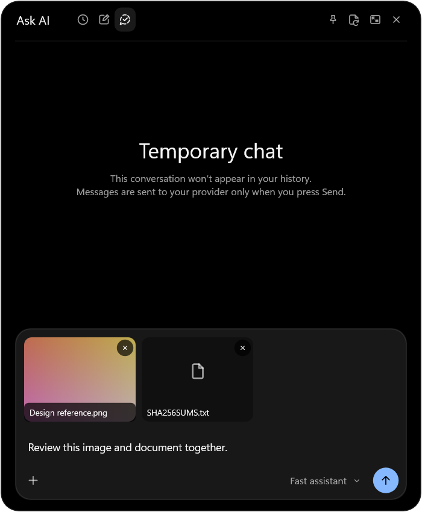

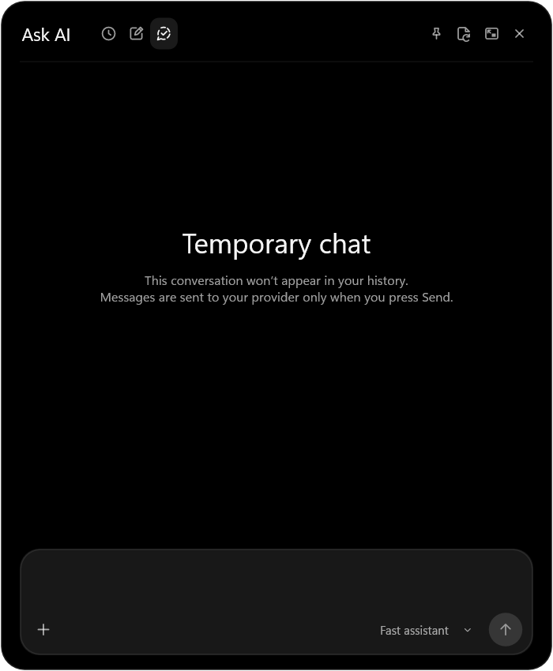

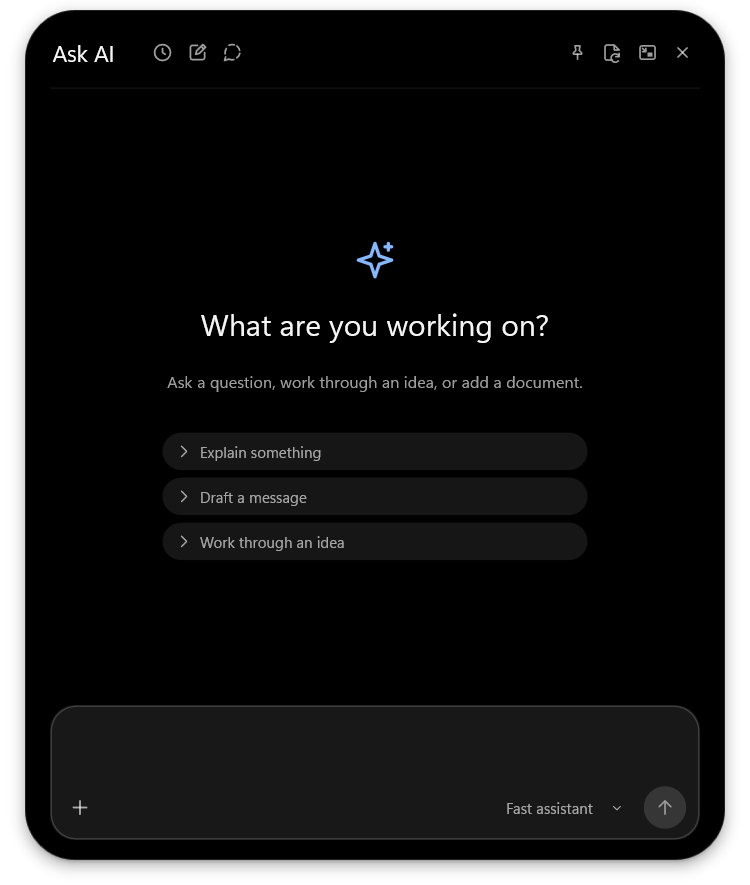

Select the mini-window icon to move the same conversation to a separate,
always-on-top window at the top right. Drag its title area and resize its edges or any corner
freely, down to 360 × 360 DIPs. Its size is remembered; Settings > AI companion
can reset it. The return icon moves back to the island, keeping the draft,
attachments, model and scroll position. Closing the mini window does not reopen
the island.

- **Keep open**, off by default, prevents dismissal when you activate another
  window. It applies to both AI hosts and is separate from the ordinary island
  pin and Search's pin. Close and Esc still dismiss AI explicitly.
- **Resume chat**, off by default, retains the current conversation, unsent
  draft, pending attachments and reading position for reopening during this app
  session. With it off, closing clears unsent text and pending files, and the
  next opening starts a fresh chat. Saved normal chats
  remain in local history. A handoff between island and mini window always
  preserves the current chat, regardless of this preference.

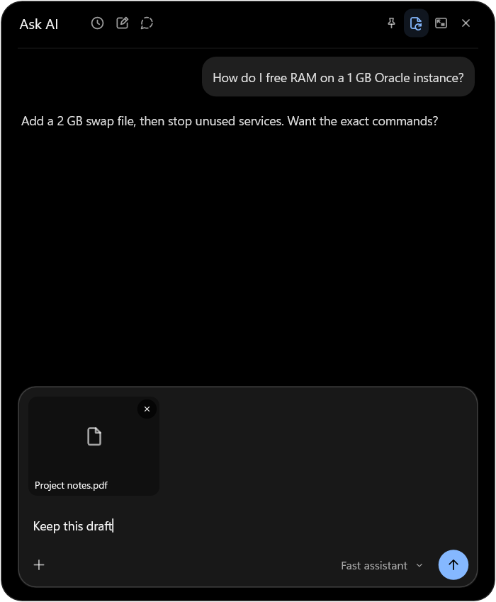

A fresh horizontal gesture closes the island workspace. Esc first closes an
open model or attachment menu, then closes AI. Outside clicks close it unless
Keep open is enabled. Changing settings to turn Keep open off also reconciles
an AI surface already in the background. Opening Search does not replace a
conversation detached in its mini window.

The mini window hides and stops its animation timers while locked, display-off,
battery saver or Widgets is active. It restores without taking focus. There is
no renderer for a closed mini window, no idle polling, and no new dependency.
Only visible generation and finite interaction transitions animate. A request
already sent uses the existing provider cancellation/timeout path; opening or
moving the workspace never sends a message.

Provider settings, keys, encryption, temporary chats and explicit attachment
access retain their existing behavior. See [privacy](../PRIVACY.md).

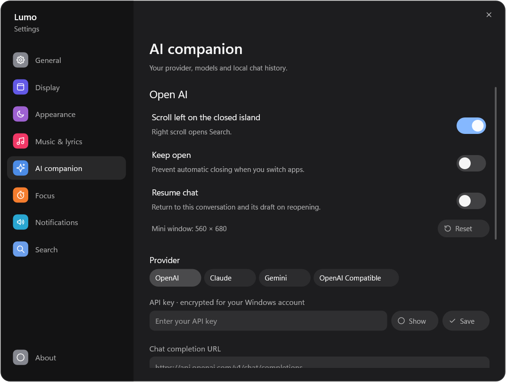

Text and Markdown replies render Windows color emoji using the system fonts.
No emoji images, font downloads or background rendering service are required.

The empty composer and Search query have no placeholder or visible caret.
Once text is entered, the focused caret blinks at the Windows rate, restarting
after edits and pointer movement. Clearing the field hides it and stops its
blink wake. A
selection hides the caret. One-shot wakes stop when focus is lost, the window
is hidden, the session is locked, the display is off or battery saver is on.
Clicking the background outside the attachment menu dismisses it and consumes
the press, including a press over Send.

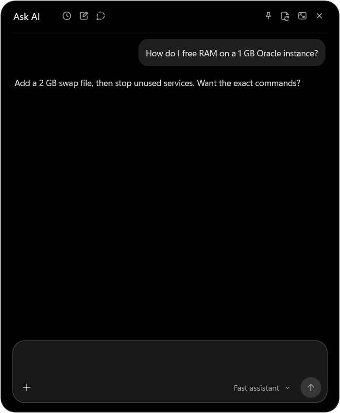

Models with reported deprecation or availability restrictions cannot be selected
or sent to. **Settings > AI companion > Hide unavailable models** defaults to on
and appears only for Hack Club AI URLs. Turn it off to inspect disabled rows and
their reasons. Refresh updates the catalog and clears session refusal flags;
unknown availability remains selectable. See [model availability](ai-companion.md#model-availability)
for detection limits, recovery and provider references.

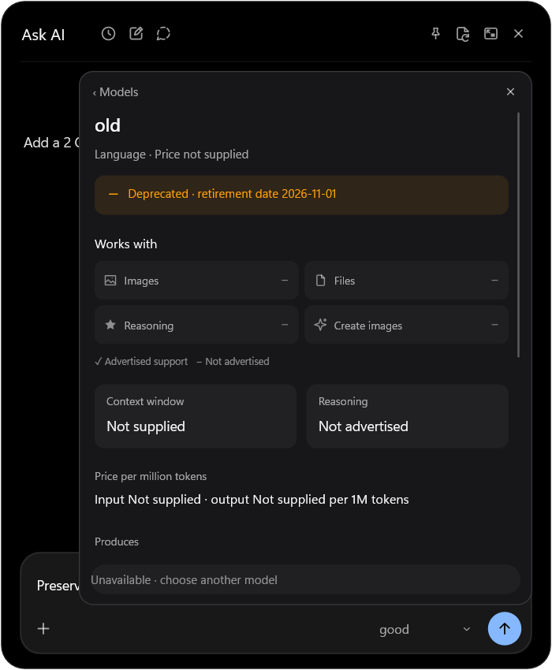

The redesigned model picker uses a funnel icon for its separate filter popover.
The catalog stays visible behind it. Hover over **ⓘ** for a compact capability
preview with icons and checkmarks; click for the detailed sheet, including
availability, context, reasoning and prices. These are provider-advertised
capabilities and prices, not account usage or benchmark scores. Provider names
appear only in explicit details. Outside clicks and Escape dismiss the filter
before the parent model picker.

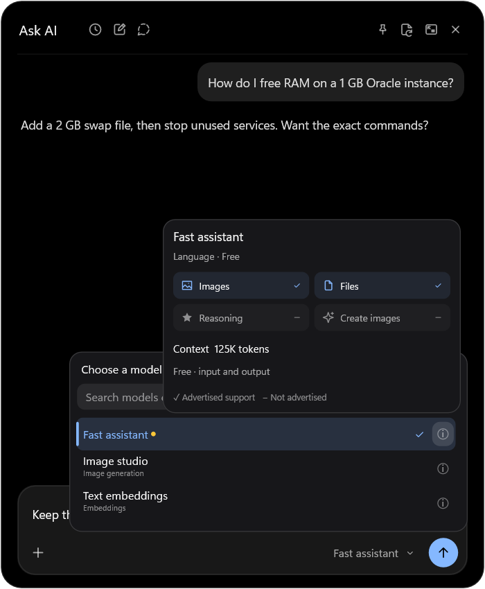

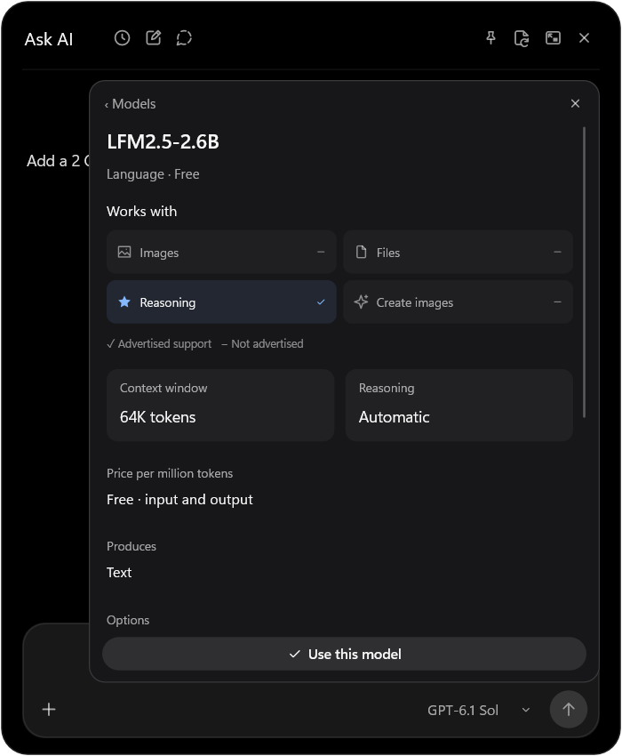

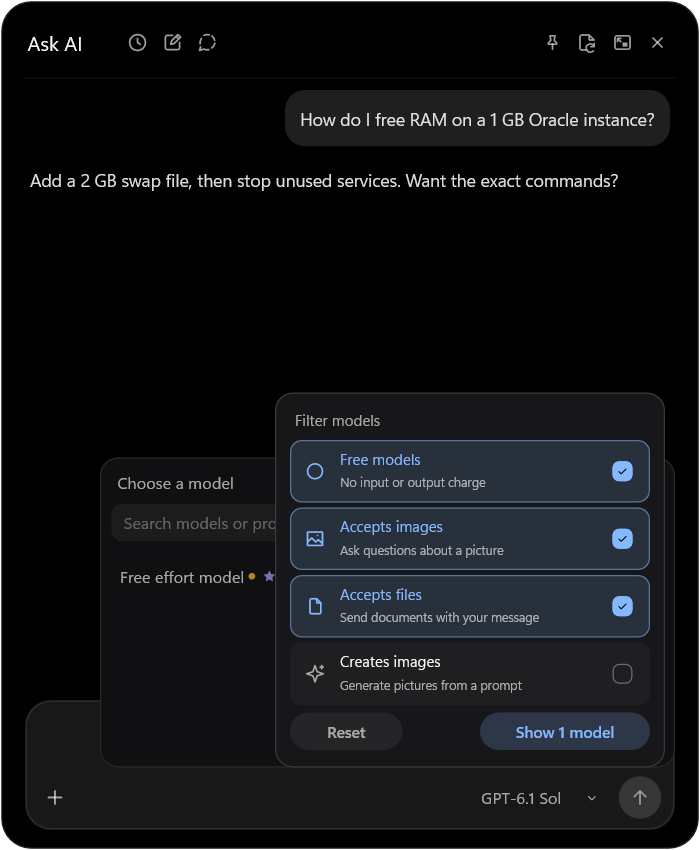

The filter popover stays anchored while options change, even when a long catalog
shrinks to just a few matches. The result count updates without moving the
checkboxes.

With a mouse, wheel **up** over the closed island to open AI, or **down** to open
Search. Over the Search/AI header, another deliberate gesture returns to Time before a later gesture opens a workspace.
Inside the chat, wheel scrolling still reads the conversation. Touchpad left/right
gestures retain their current behavior. **Settings > General > Mouse wheel
shortcuts** is enabled by default; Shift+wheel retains the compact clock/system/
network views. See [input compatibility](search.md#mouse-and-touchpad-input).

The AI toolbar starts eight DIPs closer to the top in both hosts; the composer
keeps its bottom spacing. Unpinned AI dismisses on an outside press even when
wheel opening did not activate it. Its short-lived outside-click observer does
not record input and is absent while closed, pinned, locked or display-off.
Touchpad reversals and renewed strokes work without a finger lift; small inertia
is ignored. A workspace scroll gesture closes to Time first instead of jumping
directly from AI to Search. Chat content scrolling remains reserved for reading.
