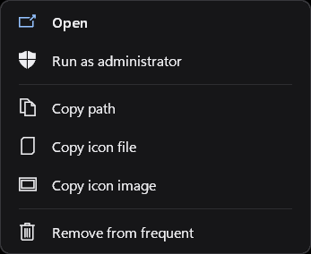
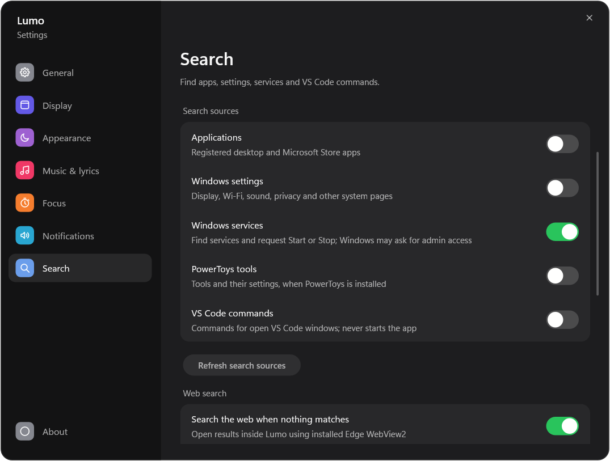
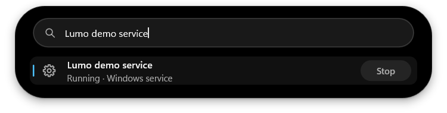
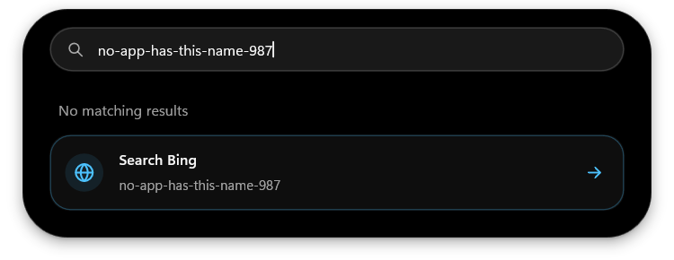
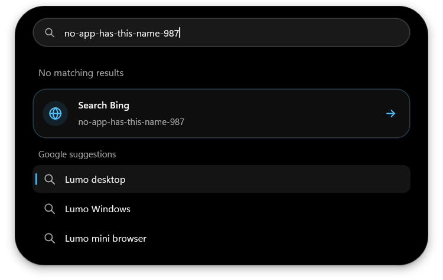
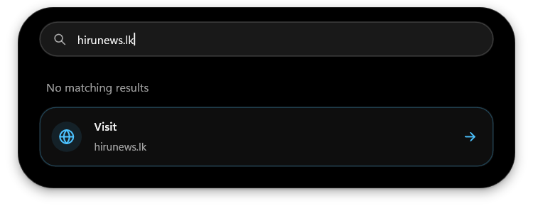
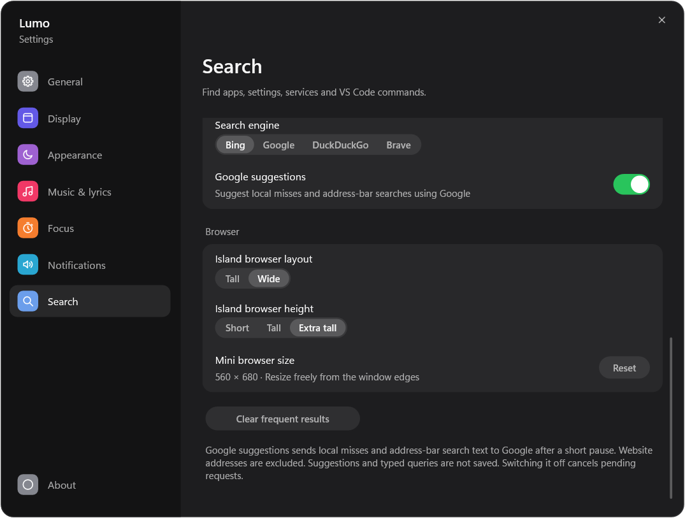
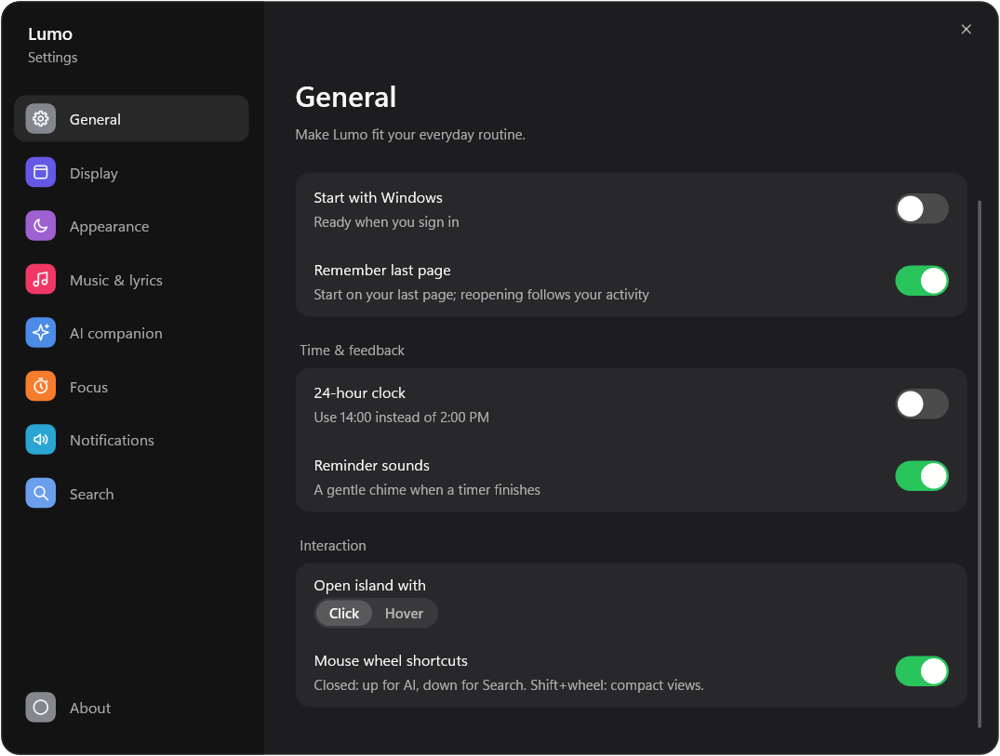
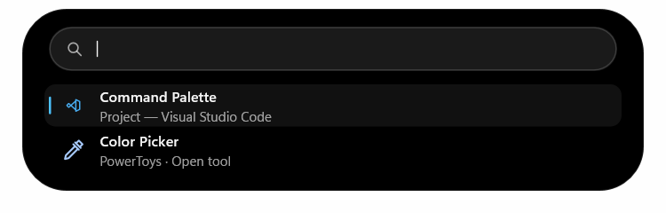

# Search

Scroll right with a touchpad or down with a mouse wheel over the closed island
to open Search. A fresh horizontal swipe or Escape closes it. Clicking outside
also closes it unless Keep open is enabled.

Search opens with an empty, full-width field. Below it, small pinned-app icons
come first in their saved order, followed by recently opened applications,
newest first. An app appears only once. **Lumo Browser** is a built-in search
result and is pinned by default. Browser is enabled for new profiles; an existing
profile's disabled Browser preference is respected. Nothing loads a webpage
just from showing Search.

Right-click an application result or icon and choose **Pin app** or **Unpin app**.
Pinned icons show a small pin badge at their bottom-right. Drag a pin onto another
pin to change their order; dropping outside the pins cancels the move. Matching
pins also come first in typed results, without showing pins that do not match.
App IDs and their order are saved in the existing profile. Up to 32 apps can be
pinned; unpinning Lumo Browser is remembered across restarts.

The visible icon count follows the window width and spacing, capped at 16. Scroll
over the strip to reveal overflow, or use Up/Down or Tab to select an icon and
bring it into view. Hover identifies the app; click or Enter opens it. Services,
Windows settings and tools are not pinnable. Missing catalog apps keep their pin
records and reappear when available; disabled sources remain hidden.

Full result rows appear only while typing. Clearing the field fades the old rows
away and returns to the icon strip. The field keeps its full width in both
states, with no separate browser button or browser-icon setting. The finite
160 ms result fade stops after settling and snaps in battery saver. Search
sources and suggestions are configured under **Settings > Search**.

Registered desktop/Store apps, Windows settings and enabled local integrations
use strict name/source matching. General file/folder search and Lumo commands are
excluded. Up/Down or Tab selects results, Page Up/Down moves five rows, and Enter
opens the selection. Ctrl+Enter explicitly opens a web search even with local
matches; an empty query opens a blank browser page.

The search/address field does not switch between Search and Browser when
scrolled vertically, including right-button + wheel gestures. Open Browser with
the Lumo Browser result/pin or Ctrl+Enter.

## Blank browser pages

Browser opens to a quiet native starting hint: **Start browsing**, with a short
instruction to use the address bar. It has no homepage, pinned-site icons, add
controls, branding or page search field. The idle address bar reads **Search or
enter a web address**. Clicking it shows an empty editor and hides the page hint;
the prompt is never inserted into typed text. Clicking the background or pressing
Escape discards the address edit and immediately restores the toolbar icons,
even after clearing all text. Clicks on suggestions still select them normally.
The starting hint starts no WebView, network request, background worker or
repeating timer. The compact navigation bar has no Home or
bookmark/star action.

Settings now separates **Search** (sources, suggestions, recent apps) from **Browser** (web enablement, engine, layout and ad blocking).
**Settings > Shortcut guide** lists keyboard and gesture controls by context.

## Recent applications and context menus

After pinned apps, only previously opened applications are shown as recent icons on opening Search.
The most recently opened app comes first, independently of its old usage count.
A fresh profile has no invented history. **Settings > Search > Clear recent apps**
clears the stored usage while preserving pins. Query text is not saved. Retired file identifiers are
removed when loading older data.

Right-click a result for a dark, rounded native Windows menu, with keyboard
navigation, accessible item names and commands specific to the result. Apps
offer **Open**, **Run as administrator** where Windows supports it, **Copy
path**, **Copy icon file** and **Copy icon image**. Store apps without a
file path offer Copy app link instead. Administrator activation uses Windows'
own Shell verb and UAC prompt. Windows Settings results offer Open and Copy
settings link. Service menus offer only supported Start/Stop actions. VS Code
and PowerToys menus run the selected command or tool. Web results offer Open,
Copy link and Open in default browser. A recent application can be removed individually;
**Settings > Search > Clear recent apps** clears all saved counts.
Shift+F10 or the keyboard Menu key opens the selected result's menu.

## Services, PowerToys and VS Code commands

Each source has its own toggle in **Settings > Search**. Windows services
default to off; PowerToys and VS Code commands default to on.
**Refresh search sources** refreshes the app catalog and optional integrations.
Extra sources are read once when Search opens or you refresh them. There is
no idle polling, browser debugging port, extension, background folder watcher
or startup scan. Closing Search, locking, display-off and battery saver cancel
pending discovery. Large or unavailable sources report a status instead of
claiming the search was complete.

**Windows services:** search the display name or internal name, including
queries such as `spooler service` or `stop spooler`. Compact results show the
last-read state and a Start or Stop button when that operation is available.
Right-click offers the same actions. Enter opens Windows Services; it never
silently toggles a service. State is re-read on opening, refresh and after a
control request, without a timer that keeps checking it. Windows may ask for
administrator permission for a selected operation. Cancelling it reports a
cancelled request. Startup types are unchanged, drivers are excluded, and
running dependent services are never stopped automatically. Up to 1,024
services are cached.

**PowerToys:** installed PowerToys exposes settings for individual modules.
Its running, enabled tools also offer direct activation, including Color Picker,
FancyZones editor, Hosts File Editor, Screen Ruler, Text Extractor, Shortcut
Guide, Registry Preview, Environment Variables and Workspaces editor. Open a
module's settings to enable it, then refresh Search if its tool is missing.
Lumo uses the same [activation events](https://github.com/microsoft/PowerToys/blob/main/src/common/interop/shared_constants.h)
and [settings arguments](https://github.com/microsoft/PowerToys/blob/main/src/common/Common.UI/SettingsDeepLink.cs)
as PowerToys' own launcher, and never turns modules on automatically.

**VS Code:** open windows expose Command Palette, Settings, quick file search,
Find in Files, Go to Symbol, terminals, Extensions, Source Control, Explorer,
Run and Debug, Problems and New File. These commands use VS Code's standard
Windows keyboard bindings after verifying and focusing that exact Code window.
Custom keybindings can change their behavior. Command Palette gives access to
other commands in VS Code. Results appear only while Code or Code Insiders
windows are already open. Lumo checks the original window/process again before
sending a shortcut and never launches Code. Closed windows are removed from
cached results on the next Search UI update. There is no idle watcher or poll.

Browser bookmarks/tabs, browser settings actions and saved custom app actions
have been removed. Their old preferences are ignored and not saved again; the
previous App actions toggle migrates to VS Code commands.

## When nothing matches

The island resizes to fit its contents. An unmatched query with web search
enabled uses a compact 204-DIP panel, rather than the full result-list height.
It shows a short local-search status and one web-search card with a globe,
the selected provider, the query preview and a clear right arrow. Click the
card or press Enter to open the provider inside the island. A URL or bare
domain instead shows **Visit** and opens the website directly. `http://`,
`https://`, `www.` and domains such as `hirunews.lk` are recognized; bare
domains use HTTPS. No Google suggestion request is made for website addresses.
Right-clicking
the card still offers its context menu.

With web search off, the compact empty state suggests trying another name.
Loading, unavailable applications and battery-saver states have their own
status; they are not described as a successful no-match search. An empty query uses the search bar and recent-app strip described above. Matching result lists grow
to fit up to five visible rows.

## Optional web search

Enable **Web search** in **Settings > Browser**, and choose Bing, Google,
DuckDuckGo or Brave. It is enabled in new profiles and can be disabled in Settings > Browser. When local search finds nothing,
choose the explicit Search provider action to send the query to that engine.
Typing alone never sends a query to a web service unless optional Google
suggestions are enabled.

Web results open inside the island through the installed Microsoft Edge
Evergreen WebView2 Runtime. No browser engine is bundled. The packages include
Microsoft's small 165,336-byte WebView2Loader.dll locator; keep it beside
lumo.exe when using the unpacked portable app. The loader is loaded only on
first web use, not at startup. If the shared Runtime is unavailable, Search
shows an installation error instead of silently opening another browser.

The island expands vertically into a tall browser at the same 560-DIP width
as Search, with a rounded, inset webpage viewport. A short header crossfade
accompanies its height spring, then stops. One unified address bar contains the title and navigation controls; there is
no second toolbar row. At narrow mini-browser sizes an overflow menu preserves
space for the title and exposes additional commands. Standard chevrons move backward and forward
through page history; Back returns to local results when there is no earlier
page. Forward is disabled when no forward history exists.

**Settings > Browser** offers Tall or Wide layout and Short, Tall or
Extra tall height presets (480, 680 or 840 DIPs, limited to available space).
Tall is the default; Wide uses a 900-DIP browser. Pages render at normal size
(100% zoom) with the normal Windows desktop user agent. Lumo does not fit,
scale or emulate a phone; sites can respond normally to the available width.
The retired desktop-fitting preference is ignored when older settings load.

The combined address/search field shows the webpage title while browsing,
falling back to the site address until a title is available. Click it or use
Ctrl+L to enter editing mode: all icons disappear and the full URL appears.
Click to place the cursor, drag to select, or double-click to select the whole
URL, including slashes. Leaving the editor restores the title and controls.
Shift+click and Shift+Arrow/Home/End extend the selection. Ctrl+A/C/X/V select
all, copy, cut and paste. **Ctrl+L** selects the full address; **Enter** opens an address
or searches with the chosen engine. Typing keeps the current page open and
makes no network request unless optional Google suggestions are enabled for
search text. Bare domains use HTTPS and never request suggestions. Loading progress fills the
entire rounded address field behind its text and controls, including its trailing
edge, with a line along the bottom. It follows actual navigation milestones
and disappears when loading finishes. Reload changes to Stop during loading. **Ctrl+R / F5** reloads;
**Alt+Left / Alt+Right** moves through history. Tab from the address field moves
into the webpage. Page errors offer a clear retry action.

The external-link icon (**Open in browser**) continues the current page, including its latest navigation
or redirect, in your Windows default browser. Web links stay inside the view,
and non-HTTP(S) navigation is refused.
By default, closing Search closes the browser controller and its mouse hook. WebView2
keeps its separate browser profile under Lumo's local cache, in SearchWeb.
The selected provider's privacy policy applies to web queries and pages.

## Mini browser

Select **Open mini browser** in the browser toolbar to move the current page
into an always-on-top window at the top right, like the mini music player.
Drag the empty space around its toolbar or resize from its edges. Sizes are
remembered, including arbitrary dimensions, with a 280 × 200-DIP minimum and
the current screen as the upper limit. Settings shows the current size and a
Reset button. The matching
return icon moves the page back into the island. Both actions preserve the
same page, history and scroll position; they do not start another browser.
Local app search and the island's other pages remain available alongside it.
A new explicit web search uses the open mini browser.

The mini browser keeps the same address, navigation, reload/stop and default
browser controls. **Ctrl+L** focuses its address field. **Esc** cancels address editing first;
otherwise it closes the mini browser, as do its close icon and **Alt+F4**. Return to the island
when you want to keep browsing there instead.

The native webpage and transparent chrome share pixel-snapped bounds. A solid
two-pixel seal keeps the rounded page edge from showing the desktop behind it.
Chrome repaints only for input or navigation events. The window is hidden and
its page suspended while the session is locked, the display is off, Widgets
is open, or battery saver is on. If the controller must be released, reopening
restores the last address. The extra window renderer exists only while detached.

## Keep open and resume

Two independent toggles live inside the browser address bar (or its overflow
menu at narrow sizes). These toggles are separate from Local Search's pinned apps. Their accent background
indicates when they are on; hover shows the name and current behavior. Both
are off by default, and their preferences stay on until you turn them off.

- **Pin / Keep Search open:** prevents automatic closing when leaving the island
  or switching apps. Escape and a horizontal swipe still
  close it explicitly. This does not change the ordinary island's pin setting.
- **Resume page:** preserves the browser page across collapse/reopen during this
  app session, including history, page state and scroll position. Search still
  opens with an empty field; explicitly open Browser to return to the retained page.
  Turning Resume off releases its page on closing Browser.

The retained browser is hidden and suspended when Search closes. It has no
mouse hook while hidden and adds no polling or loading-animation timer. If the
installed Runtime refuses suspension, Lumo closes that controller and keeps the
current URL to reload on reopening. That fallback cannot preserve DOM, scroll or
browser history. Lock/display-off also close Search; battery saver releases the
controller. Suspended pages can retain browser memory until Resume page is
turned off or Lumo exits. Page URLs/queries are kept in memory, not saved to the
settings file; only the two toggle preferences persist across app restarts.

Local packages include the compact launcher, unified address bar and native result menus.

## Local, bounded and on demand

**Search suggestions** is a separate opt-in under Settings > Search. It needs
web search enabled and at least two characters. Suggestions appear for local
queries without matches and search text typed in the focused address editor.
Website addresses are excluded. One 350-ms debounce wake starts a cancelable
request to Google's suggestion service. At most four suggestions are shown.
Up/Down selects address suggestions and Enter opens one using your chosen
engine; Tab fills the selected suggestion without navigating, and Esc cancels editing. Local suggestion results search Google. Native
webpage pixels are occluded behind the dropdown without resizing the page.

Responses are capped at 32 KiB with an eight-second request limit. Stale,
malformed and canceled responses are ignored. Closing Search, changing the
query, disabling suggestions or being away cancels the request immediately.
There is no polling or automatic retry. If Google is unavailable, the normal
explicit web action remains usable. Suggestions are not written to disk.

App discovery reads Windows' Applications folder on first open, explicit
refresh, or an open after its ten-minute cache age. It is limited to 2,048
entries and a 2 MiB catalog budget. Unregistered portable apps may not appear.
Visible app icons load in batches of at most six on a short-lived worker,
with a 64-icon cache (up to 576 KiB of decoded pixels, plus renderer cache).

Closing Search cancels discovery and icon work and releases the enlarged surface
after its closing animation. With Resume page off it also releases the query/view;
with it on the view is parked without keeping the frame clock running.
Locking Windows or turning off the display closes Search. Battery saver pauses
discovery, icon work and the embedded browser. No new work runs while the
island is closed. The optional browser bindings are built for size and the
shared Runtime is never started for local search.

The mini browser resizes diagonally from all four rounded corners as well as
horizontally or vertically from its edges. Corner targets scale with Windows
DPI and reach the visible part of the rounded frame.

## Mouse and touchpad input

**Settings > General > Mouse wheel shortcuts** is on by default. With the
pointer over the closed island, mouse wheel down opens Search and wheel up
opens AI (if enabled in Add-ons). Over an open Search/AI header, another deliberate wheel gesture closes to Time
first. A subsequent gesture on the closed island opens the requested workspace. Over the ordinary expanded header, up/down selects
previous/next sections. Scroll inside search results, chat, model popovers,
websites and other content as usual. Music's optional track-scroll behavior
remains on its player content.

**Shift + mouse wheel** cycles the closed clock/activity, performance and
network views, if compact scrolling is enabled. Touchpad vertical scrolling
continues to cycle those views. Touchpad horizontal gestures retain right for
Search, left for AI and a fresh gesture to close the open workspace. Their
existing per-feature settings remain independent of mouse-wheel shortcuts.

Lumo identifies input sources on demand through Windows. A scoped touchpad-aware
registration distinguishes precision-touchpad packets from mouse packets; it
lasts only while the pointer is over the island and is released on leave, lock
or display-off. Windows still converts touchpad gestures into the existing wheel
messages. Input-source identification has no polling, raw-input subscription, hook or
background worker; outside-click dismissal uses the separate scoped observer
described below. Input handling continues in battery saver; it does not add
any repeating work.

Older Windows versions may not expose the optional identification API. If the
source cannot be identified safely, Lumo keeps the previous scrolling behavior
rather than guessing from wheel distance. A legacy driver that reports a touchpad
as a mouse cannot be reliably distinguished; turn off **Mouse wheel shortcuts**
if it misidentifies your device. Touchpad and tilting-wheel horizontal gestures,
the Ctrl-hover AI shortcut and Settings' Open Search button remain available.

Implementation references: [Windows input message source](https://learn.microsoft.com/en-us/windows/win32/api/winuser/nf-winuser-getcurrentinputmessagesource),
[scoped touchpad capability and default wheel conversion](https://learn.microsoft.com/en-us/windows/win32/input-precisiontouchpad/registertouchpadcapable).

Outside clicks dismiss an unpinned Search/AI workspace even when Windows kept
the background app active during wheel opening. Inside clicks, WebView children,
attachment pickers, result menus and Keep open retain their expected behavior.
A scoped mouse-button observer exists only while dismissal is needed; closing,
pinning, lock or display-off releases it. It records no input history and adds
no idle polling. See [privacy](../PRIVACY.md).

Horizontal touchpad input now accepts a deliberate reversal after a short
200-ms action guard, or renewed sustained movement after 650 ms, without needing
to lift and reapply fingers. Distance thresholds suppress small inertial tails;
no queued action runs after input stops. A deliberate close returns to Time
before a later gesture can open the other workspace.

VS Code command rows use a small blue source mark instead of a full-size app
icon or repeated provider name in each command title. Commands still require a
live Code window. PowerToys results load native icons from their installed tool
executables, checking current WinUI3Apps and older layouts. A purpose-specific
vector fallback appears if artwork is unavailable; Color Picker uses a pipette.
Icons use the existing six-item worker batches and bounded 64-icon memory cache.
Refresh search sources clears failed/stale icon entries so they can be retried.
No tool is launched to read its icon. Layout references come from
[PowerToys' signed binary inventory](https://github.com/microsoft/PowerToys/blob/main/.pipelines/ESRPSigning_core.json).

The result context menu remains a native Win32 menu with keyboard support,
accessible names and Windows dismissal. It now uses compact 34-DIP action rows,
quieter group dividers, rounded corners, grayscale text and a distinct primary
Open action. Unsupported administrator actions remain disabled. Copy path/link,
icon-file/image copying and removing frequent results preserve their behavior.

## Scrolling results

Search scrolls in pixels, preserving small touchpad deltas and easing mouse-wheel
movement. Scrolling leaves keyboard selection in place. Arrow keys and Page Up /
Page Down reveal the selected result. Only visible result portions receive clicks.
The short scroll animation stops when settled and snaps in battery saver.

Empty Search fields hide the text caret. Typing shows the focused caret with
Windows' normal blink timing, and clearing the text hides it and stops blink
redraws. Keyboard focus stays ready for input.

See [local cost and validation notes](search-rework-cost.md).
