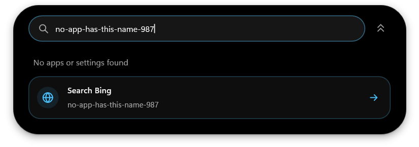
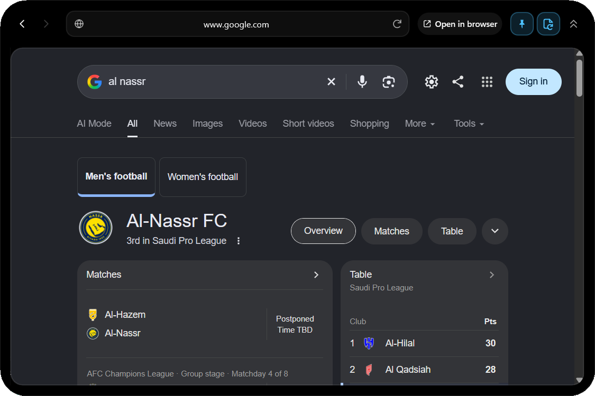

# Search

Swipe left or right over the closed island to expand it into Search. Swipe
again anywhere over Search, including the embedded web page, to collapse it.
Esc and the collapse control also close it. Regular open island pages and
Settings retain their normal horizontal navigation.

Search contains registered desktop and Microsoft Store apps, Windows Settings
destinations. File/folder search has been removed. Lumo actions and
Lumo preference pages are not search results. There are no source chips,
repeated subtitles, result-count footer, footer gear or selected-row Open label.
App icons use Windows' system image list with native transparency.

Names and explicit Windows Settings keywords must match. Loose character
subsequences and generic app metadata are not matches. Up/Down or Tab selects
results, Page Up/Down moves five rows, Enter opens, and the vertical wheel
scrolls results. A missing match shows a clear empty state; failed or partial
sources are reported rather than presented as a successful complete search.

## Frequent results and context menus

On opening Search, the list contains results you have opened most frequently,
with recency breaking ties. A fresh profile has no invented suggestions.
Only result identifiers, counts and last-use times are saved in data.json;
query text is not saved. Retired file-result identifiers are removed from
the loaded history; old file-search preferences are ignored.

Right-click an app for its native Windows Shell menu, including
administrator/different-user verbs where Windows supports them, Properties,
Copy as path and installed Shell extensions. Windows Settings results offer
Open and Copy settings link. The web-search action offers Open, Copy search
link and Open in default browser. A frequent result can be removed individually;
**Settings > Search > Clear frequent results** clears all saved counts.
Shift+F10 or the keyboard Menu key opens the selected result's menu.

## When nothing matches

The island resizes to fit its contents. An unmatched query with web search
enabled uses a compact 204-DIP panel, rather than the full result-list height.
It shows a short local-search status and one web-search card with a globe,
the selected provider, the query preview and a clear right arrow. Click the
card or press Enter to open the provider inside the island. Right-clicking
the card still offers its context menu.

With web search off, the compact empty state suggests trying another name.
Loading, unavailable applications and battery-saver states have their own
status; they are not described as a successful no-match search. A fresh profile
with no frequent results also uses a compact panel. Matching result lists grow
to fit up to five visible rows.

## Optional web search

Enable **Web search** in **Settings > Search**, and choose Bing, Google,
DuckDuckGo or Brave. It is off by default. When local search finds nothing,
choose the explicit Search provider action to send the query to that engine.
Typing alone never sends a query to a web service.

Web results open inside the island through the installed Microsoft Edge
Evergreen WebView2 Runtime. No browser engine is bundled. The packages include
Microsoft's small 165,336-byte WebView2Loader.dll locator; keep it beside
lumo.exe when using the unpacked portable app. The loader is loaded only on
first web use, not at startup. If the shared Runtime is unavailable, Search
shows an installation error instead of silently opening another browser.

The island grows into a compact browser with a macOS-inspired toolbar and a
rounded, inset webpage viewport. Standard chevrons move backward and forward
through page history; Back returns to local results when there is no earlier
page. Forward is disabled when no forward history exists.

The combined address/search field shows the current site while browsing.
Click it to place the cursor, drag to select, or double-click a word.
Shift+click and Shift+Arrow/Home/End extend the selection. Ctrl+A/C/X/V select
all, copy, cut and paste. **Ctrl+L** selects the full address; **Enter** opens an address
or searches with the chosen engine. Typing keeps the current page open and
makes no network request. Bare domains use HTTPS. A thin progress line inside
the field follows actual navigation milestones and disappears when loading
finishes. Reload changes to Stop during loading. **Ctrl+R / F5** reloads;
**Alt+Left / Alt+Right** moves through history. Tab from the address field moves
into the webpage. Page errors offer a clear retry action.

**Open in browser** continues the current page, including its latest navigation
or redirect, in your Windows default browser. Web links stay inside the view,
and non-HTTP(S) navigation is refused.
By default, closing Search closes the browser controller and its mouse hook. WebView2
keeps its separate browser profile under Lumo's local cache, in SearchWeb.
The selected provider's privacy policy applies to web queries and pages.

## Keep open and resume (unpackaged changes)

Two independent toggles live at the top right in both local Search and the
browser. Their accent background indicates when they are on; hover shows the
name and current behavior. Both are off by default, and their preferences stay
on until you turn them off.

- **Pin / Keep Search open:** prevents automatic closing when leaving the island
  or switching apps. Escape, a horizontal swipe and the collapse button still
  close it explicitly. This does not change the ordinary island's pin setting.
- **Resume page:** preserves the current query/results and web page across
  collapse/reopen during this app session, including browser history, page state
  and scroll position. Turning it off restores the usual fresh Search on close.

The retained browser is hidden and suspended when Search closes. It has no
mouse hook while hidden and adds no polling or loading-animation timer. If the
installed Runtime refuses suspension, Lumo closes that controller and keeps the
current URL to reload on reopening. That fallback cannot preserve DOM, scroll or
browser history. Lock/display-off also close Search; battery saver releases the
controller. Suspended pages can retain browser memory until Resume page is
turned off or Lumo exits. Page URLs/queries are kept in memory, not saved to the
settings file; only the two toggle preferences persist across app restarts.

These changes have not been packaged. Existing download packages are unchanged.

## Local, bounded and on demand

App discovery reads Windows' Applications folder on first open, explicit
refresh, or an open after its ten-minute cache age. It is limited to 2,048
entries and a 2 MiB catalog budget. Unregistered portable apps may not appear.
Visible app icons load in batches of at most six on a short-lived worker,
with a 64-icon cache (up to 576 KiB of decoded pixels, plus renderer cache).

Closing Search cancels discovery and icon work and releases the enlarged surface
after its closing animation. With Resume page off it also releases the query/view;
with it on the view is parked without keeping the frame clock running.
Locking Windows or turning off the display closes Search. Battery saver pauses
discovery, icon work and the embedded browser. No new work runs while the
island is closed. The optional browser bindings are built for size and the
shared Runtime is never started for local search.
