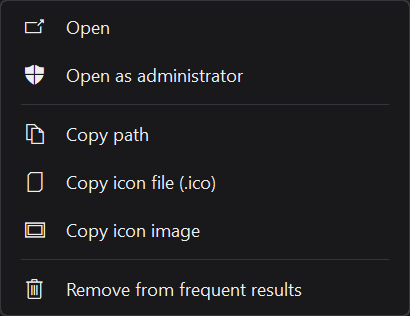

# Search

Swipe left or right over the closed island to expand it into Search. Swipe
again anywhere over Search, including the embedded web page, to collapse it.
Esc also closes it. The launcher and embedded browser have no close button.
Clicking outside closes Search unless its **Keep open** pin is on, including
when the address editor is unfocused or the click dismisses a native result
menu. Clicking inside the embedded webpage keeps Search open. The ordinary
island pin does not override Search's own Keep open preference.
Regular open island pages and
Settings retain their normal horizontal navigation.

Search contains registered desktop and Microsoft Store apps, Windows Settings
destinations, and optional local service, PowerToys and VS Code command
sources. General file/folder search has been removed. Lumo actions and
Lumo preference pages are not search results. There are no source chips,
repeated app subtitles, result-count footer, footer gear or selected-row Open label.
Service state and VS Code window context appear only where they identify a result.
App icons use Windows' system image list with native transparency.

The local launcher uses a 560-DIP-wide surface with 40-DIP row spacing,
24-DIP icons and a subtle selection highlight with an inset accent marker.
Rows respond to hover and press without adding animation. Its
height follows the result count, so a single match takes only one compact row.
The search field has a neutral border and no browser button. **Ctrl+Enter**
searches the current query even when local matches exist, visits a URL or bare
domain directly, or opens the chosen engine's home page for an empty field.
Enable web search in Settings first. No browser starts until an explicit web
action is selected.

Names and explicit source keywords must match. Loose character
subsequences and generic app metadata are not matches. Up/Down or Tab selects
results, Page Up/Down moves five rows, Enter opens, and the vertical wheel
scrolls results. A missing match shows a clear empty state; failed or partial
sources are reported rather than presented as a successful complete search.

## Frequent results and context menus

On opening Search, the list contains results you have opened most frequently,
with recency breaking ties. A fresh profile has no invented suggestions.
Only result identifiers, counts and last-use times are saved in data.json;
query text is not saved. Retired file-result identifiers are removed from
the loaded history; old file-search preferences are ignored.

Right-click a result for a dark, rounded native Windows menu, with keyboard
navigation, accessible item names and commands specific to the result. Apps
offer **Open**, **Open as administrator** where Windows supports it, **Copy
path**, **Copy icon file (.ico)** and **Copy icon image**. Store apps without a
file path offer Copy app link instead. Administrator activation uses Windows'
own Shell verb and UAC prompt. Windows Settings results offer Open and Copy
settings link. Service menus offer only supported Start/Stop actions. VS Code
and PowerToys menus run the selected command or tool. Web results offer Open,
Copy link and Open in default browser. A frequent result can be removed individually;
**Settings > Search > Clear frequent results** clears all saved counts.
Shift+F10 or the keyboard Menu key opens the selected result's menu.

## Services, PowerToys and VS Code commands

Each source has its own toggle in **Settings > Search**. Windows services
default to off; PowerToys and VS Code commands default to on.
**Refresh search sources** refreshes the app catalog and optional integrations.
Extra sources are read once when Search opens or you refresh them. There is
no idle polling, browser debugging port, extension, background folder watcher
or startup scan. Closing Search, locking, display-off and battery saver cancel
pending discovery. Large or unavailable sources report a status instead of
claiming the search was complete.

**Windows services:** search the display name or internal name, including
queries such as `spooler service` or `stop spooler`. Compact results show the
last-read state and a Start or Stop button when that operation is available.
Right-click offers the same actions. Enter opens Windows Services; it never
silently toggles a service. State is re-read on opening, refresh and after a
control request, without a timer that keeps checking it. Windows may ask for
administrator permission for a selected operation. Cancelling it reports a
cancelled request. Startup types are unchanged, drivers are excluded, and
running dependent services are never stopped automatically. Up to 1,024
services are cached.

**PowerToys:** installed PowerToys exposes settings for individual modules.
Its running, enabled tools also offer direct activation, including Color Picker,
FancyZones editor, Hosts File Editor, Screen Ruler, Text Extractor, Shortcut
Guide, Registry Preview, Environment Variables and Workspaces editor. Open a
module's settings to enable it, then refresh Search if its tool is missing.
Lumo uses the same [activation events](https://github.com/microsoft/PowerToys/blob/main/src/common/interop/shared_constants.h)
and [settings arguments](https://github.com/microsoft/PowerToys/blob/main/src/common/Common.UI/SettingsDeepLink.cs)
as PowerToys' own launcher, and never turns modules on automatically.

**VS Code:** open windows expose Command Palette, Settings, quick file search,
Find in Files, Go to Symbol, terminals, Extensions, Source Control, Explorer,
Run and Debug, Problems and New File. These commands use VS Code's standard
Windows keyboard bindings after verifying and focusing that exact Code window.
Custom keybindings can change their behavior. Command Palette gives access to
other commands in VS Code. Results appear only while Code or Code Insiders
windows are already open. Lumo checks the original window/process again before
sending a shortcut and never launches Code. Closed windows are removed from
cached results on the next Search UI update. There is no idle watcher or poll.

Browser bookmarks/tabs, browser settings actions and saved custom app actions
have been removed. Their old preferences are ignored and not saved again; the
previous App actions toggle migrates to VS Code commands.

## When nothing matches

The island resizes to fit its contents. An unmatched query with web search
enabled uses a compact 204-DIP panel, rather than the full result-list height.
It shows a short local-search status and one web-search card with a globe,
the selected provider, the query preview and a clear right arrow. Click the
card or press Enter to open the provider inside the island. A URL or bare
domain instead shows **Visit** and opens the website directly. `http://`,
`https://`, `www.` and domains such as `hirunews.lk` are recognized; bare
domains use HTTPS. No Google suggestion request is made for website addresses.
Right-clicking
the card still offers its context menu.

With web search off, the compact empty state suggests trying another name.
Loading, unavailable applications and battery-saver states have their own
status; they are not described as a successful no-match search. A fresh profile
with no frequent results also uses a compact panel. Matching result lists grow
to fit up to five visible rows.

## Optional web search

Enable **Web search** in **Settings > Search**, and choose Bing, Google,
DuckDuckGo or Brave. It is off by default. When local search finds nothing,
choose the explicit Search provider action to send the query to that engine.
Typing alone never sends a query to a web service unless optional Google
suggestions are enabled.

Web results open inside the island through the installed Microsoft Edge
Evergreen WebView2 Runtime. No browser engine is bundled. The packages include
Microsoft's small 165,336-byte WebView2Loader.dll locator; keep it beside
lumo.exe when using the unpacked portable app. The loader is loaded only on
first web use, not at startup. If the shared Runtime is unavailable, Search
shows an installation error instead of silently opening another browser.

The island expands vertically into a tall browser at the same 560-DIP width
as Search, with a rounded, inset webpage viewport. A short header crossfade
accompanies its height spring, then stops. One unified address bar contains the title and navigation controls; there is
no second toolbar row. At narrow mini-browser sizes an overflow menu preserves
space for the title and exposes additional commands. Standard chevrons move backward and forward
through page history; Back returns to local results when there is no earlier
page. Forward is disabled when no forward history exists.

**Settings > Search > Browser** offers Tall or Wide layout and Short, Tall or
Extra tall height presets (480, 680 or 840 DIPs, limited to available space).
Tall is the default; Wide uses a 900-DIP browser. Pages render at normal size
(100% zoom) with the normal Windows desktop user agent. Lumo does not fit,
scale or emulate a phone; sites can respond normally to the available width.
The retired desktop-fitting preference is ignored when older settings load.

The combined address/search field shows the webpage title while browsing,
falling back to the site address until a title is available. Click it or use
Ctrl+L to enter editing mode: all icons disappear and the full URL appears.
Click to place the cursor, drag to select, or double-click to select the whole
URL, including slashes. Leaving the editor restores the title and controls.
Shift+click and Shift+Arrow/Home/End extend the selection. Ctrl+A/C/X/V select
all, copy, cut and paste. **Ctrl+L** selects the full address; **Enter** opens an address
or searches with the chosen engine. Typing keeps the current page open and
makes no network request unless optional Google suggestions are enabled for
search text. Bare domains use HTTPS and never request suggestions. Loading progress fills the
entire rounded address field behind its text and controls, including its trailing
edge, with a line along the bottom. It follows actual navigation milestones
and disappears when loading finishes. Reload changes to Stop during loading. **Ctrl+R / F5** reloads;
**Alt+Left / Alt+Right** moves through history. Tab from the address field moves
into the webpage. Page errors offer a clear retry action.

The external-link icon (**Open in browser**) continues the current page, including its latest navigation
or redirect, in your Windows default browser. Web links stay inside the view,
and non-HTTP(S) navigation is refused.
By default, closing Search closes the browser controller and its mouse hook. WebView2
keeps its separate browser profile under Lumo's local cache, in SearchWeb.
The selected provider's privacy policy applies to web queries and pages.

## Mini browser

Select **Open mini browser** in the browser toolbar to move the current page
into an always-on-top window at the top right, like the mini music player.
Drag the empty space around its toolbar or resize from its edges. Sizes are
remembered, including arbitrary dimensions, with a 280 × 200-DIP minimum and
the current screen as the upper limit. Settings shows the current size and a
Reset button. The matching
return icon moves the page back into the island. Both actions preserve the
same page, history and scroll position; they do not start another browser.
Local app search and the island's other pages remain available alongside it.
A new explicit web search uses the open mini browser.

The mini browser keeps the same address, navigation, reload/stop and default
browser controls. **Ctrl+L** focuses its address field. **Esc** cancels address editing first;
otherwise it closes the mini browser, as do its close icon and **Alt+F4**. Return to the island
when you want to keep browsing there instead.

The native webpage and transparent chrome share pixel-snapped bounds. A solid
two-pixel seal keeps the rounded page edge from showing the desktop behind it.
Chrome repaints only for input or navigation events. The window is hidden and
its page suspended while the session is locked, the display is off, Widgets
is open, or battery saver is on. If the controller must be released, reopening
restores the last address. The extra window renderer exists only while detached.

## Keep open and resume

Two independent toggles live inside the browser address bar (or its overflow
menu at narrow sizes). Local Search has no browser button. Their accent background
indicates when they are on; hover shows the name and current behavior. Both
are off by default, and their preferences stay on until you turn them off.

- **Pin / Keep Search open:** prevents automatic closing when leaving the island
  or switching apps. Escape and a horizontal swipe still
  close it explicitly. This does not change the ordinary island's pin setting.
- **Resume page:** preserves the current query/results and web page across
  collapse/reopen during this app session, including browser history, page state
  and scroll position. Turning it off restores the usual fresh Search on close.

The retained browser is hidden and suspended when Search closes. It has no
mouse hook while hidden and adds no polling or loading-animation timer. If the
installed Runtime refuses suspension, Lumo closes that controller and keeps the
current URL to reload on reopening. That fallback cannot preserve DOM, scroll or
browser history. Lock/display-off also close Search; battery saver releases the
controller. Suspended pages can retain browser memory until Resume page is
turned off or Lumo exits. Page URLs/queries are kept in memory, not saved to the
settings file; only the two toggle preferences persist across app restarts.

Local packages include the compact launcher, unified address bar and native result menus.

## Local, bounded and on demand

**Google suggestions** is a separate opt-in under Settings > Search. It needs
web search enabled and at least two characters. Suggestions appear for local
queries without matches and search text typed in the focused address editor.
Website addresses are excluded. One 350-ms debounce wake starts a cancelable
request to Google's suggestion service. At most four suggestions are shown.
Up/Down selects address suggestions and Enter opens one using your chosen
engine; Esc cancels editing. Local suggestion results search Google. Native
webpage pixels are occluded behind the dropdown without resizing the page.

Responses are capped at 32 KiB with an eight-second request limit. Stale,
malformed and canceled responses are ignored. Closing Search, changing the
query, disabling suggestions or being away cancels the request immediately.
There is no polling or automatic retry. If Google is unavailable, the normal
explicit web action remains usable. Suggestions are not written to disk.

App discovery reads Windows' Applications folder on first open, explicit
refresh, or an open after its ten-minute cache age. It is limited to 2,048
entries and a 2 MiB catalog budget. Unregistered portable apps may not appear.
Visible app icons load in batches of at most six on a short-lived worker,
with a 64-icon cache (up to 576 KiB of decoded pixels, plus renderer cache).

Closing Search cancels discovery and icon work and releases the enlarged surface
after its closing animation. With Resume page off it also releases the query/view;
with it on the view is parked without keeping the frame clock running.
Locking Windows or turning off the display closes Search. Battery saver pauses
discovery, icon work and the embedded browser. No new work runs while the
island is closed. The optional browser bindings are built for size and the
shared Runtime is never started for local search.
